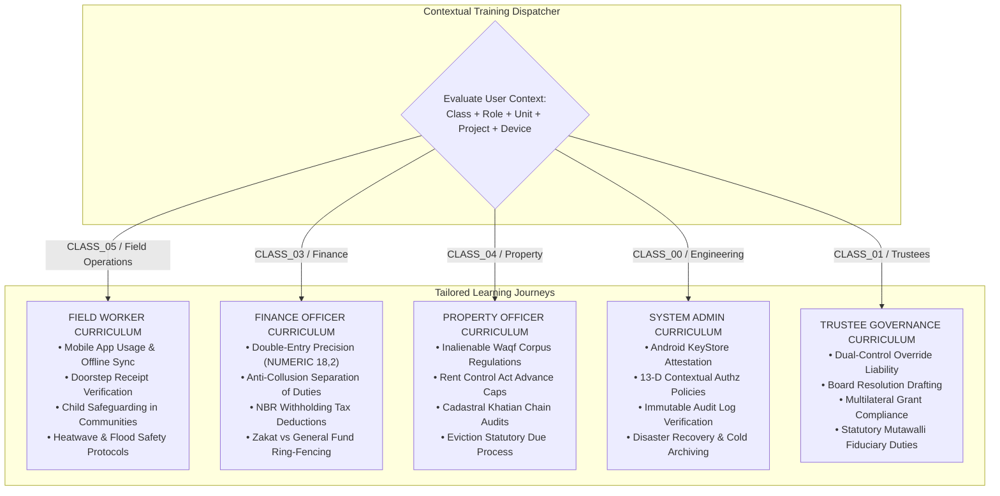

# STFL AIO — Role-Aware Training, Certification & Authorization Prerequisite Model
**Document Identity:** `STFL-DOC-2026-TRN-ARCH-V1`  
**Phase:** Prompt 12.5 Extension (Sections 63–82: Knowledge, Training, Service & Moderation)  
**Status:** SPECIFICATION ONLY — RATIFIED (READ-ONLY ARCHITECTURE PHASE)  
**Security Classification:** INTERNAL ENTERPRISE SPECIFICATION  
**Authoritative Precedent:** Extends `STFL_AIO_KNOWLEDGE_ARCHITECTURE.md` and `STFL_AUTHORIZATION_MODEL.md`

---

## 1. Role-Aware & Contextual Training Architecture

In STFL AIO, training is strictly contextual. A field worker in rural Kurigram requires a vastly different learning journey than a chartered accountant at foundation headquarters or an executive trustee in the boardroom:



---

## 2. Training Certification as an Authorization Prerequisite

To guarantee that field personnel, health workers, and finance officers do not execute critical or legally hazardous workflows without proven competency, the **13-Dimensional Contextual Authorization Engine** natively evaluates training prerequisites:

$$\mathbf{PrerequisiteRule}: \text{IF } \mathbf{Action} \in \mathcal{A}_{\text{Hazardous}} \implies \mathbf{RequireCertification}\left( \text{Actor}, \text{CourseID}, \text{Status} \equiv \text{'ACTIVE'} \right)$$

```mermaid
sequenceDiagram
    autonumber
    actor Officer as Field Credit Officer (Class 05)
    participant Client as Android Mobile Terminal
    participant Authz as 13-D Contextual Authorization Engine
    participant CertReg as Training Certification Registry (PostgreSQL)
    participant Workflow as Cash Collection Workflow

    Officer->>Client: Clicks [Collect Doorstep Microfinance Cash (৳ 5,000)]
    Client->>Authz: Pre-flight Authorization (Action: 'microfinance.collect')
    
    Authz->>Authz: Check Role & Scope (Officer holds CLASS_05 / District 1) -> PASS
    Authz->>CertReg: Query Certification (User: 'USR-042', Course: 'CRS-MFI-CASH-01')
    
    alt Certification Active & Unexpired
        CertReg-->>Authz: Certificate Found: STFL-CER-2026-000412 (Valid until 2027-04-01)
        Authz-->>Client: Decision: ALLOW (Workflow proceeds; opens receipt camera)
        Client->>Workflow: Execute collection transaction
    else Certification Expired or Missing
        CertReg-->>Authz: No Active Certificate Found (Status: EXPIRED / NEVER_TAKEN)
        Authz-->>Client: Decision: DENY (HTTP 403 Forbidden - Code: 'TRAINING_PREREQUISITE_MISSING')
        Client-->>Officer: Displays "Action Locked: Please complete the 15-minute Recertification Course on Cash Handling Safety."
    end
```

---

## 3. Training Lifecycle & Certification Architecture

Courses follow a rigorous four-tier academic structure:

```
COURSE (e.g. 'CRS-PROP-01: Waqf Lease Execution & Legal Safeguards')
   └── MODULE (e.g. 'Module 2: Premises Rent Control & Advance Caps')
        └── LESSON (e.g. 'Lesson 2.3: Calculating Maximum Permitted Advance Rent')
             └── ASSESSMENT (e.g. 'Interactive Scenario Quiz with 85% Passing Floor')
```

### Certification Invariants:
1. **Verifiable Institutional Grammar:**  
   Every completion certificate is issued a permanent institutional identifier matching:
   $$\mathbf{STFL\text{-}CER\text{-}[YEAR]\text{-}[SEQUENCE]\text{-}[CHECKSUM]}$$  
   *Example:* `STFL-CER-2026-000412-K7M2`
2. **Cryptographic Hashing:**  
   The certificate digest contains `SHA-256(student_party_id + course_id + passing_score + issue_date)`.
3. **Validity & Renewal Cycles:**  
   Certifications for high-risk operations (e.g. First Aid, Child Safeguarding, Cash Handling) enforce mandatory 12-month or 24-month renewal cycles. Expired certificates automatically revoke operational execution permissions.

---

## 4. Proposed Database Schema Specification

```sql
-- ---------------------------------------------------------------------------
-- 1. Training Courses Catalog Table
-- ---------------------------------------------------------------------------
CREATE TABLE IF NOT EXISTS training_courses (
    id                   UUID PRIMARY KEY DEFAULT gen_random_uuid(),
    course_code          TEXT NOT NULL UNIQUE,          -- CRS-PROP-WAQF-01
    title_bn             TEXT NOT NULL,
    title_en             TEXT NOT NULL,
    description_bn       TEXT,
    description_en       TEXT,
    project_id           UUID REFERENCES platform_projects(id) ON DELETE CASCADE, -- NULL = Platform Universal
    target_user_classes  TEXT[] NOT NULL,               -- e.g. ['CLASS_04', 'CLASS_05']
    target_roles         TEXT[] NOT NULL DEFAULT '{}',
    is_mandatory         BOOLEAN NOT NULL DEFAULT FALSE,
    validity_months      INTEGER NOT NULL DEFAULT 12,   -- Expiry duration (0 = Lifetime)
    passing_score_pct    INTEGER NOT NULL DEFAULT 80 CHECK (passing_score_pct BETWEEN 50 AND 100),
    version              INTEGER NOT NULL DEFAULT 1,
    status               TEXT NOT NULL DEFAULT 'ACTIVE' CHECK (status IN ('DRAFT', 'ACTIVE', 'ARCHIVED')),
    created_at           TIMESTAMPTZ NOT NULL DEFAULT now(),
    updated_at           TIMESTAMPTZ NOT NULL DEFAULT now()
);

-- ---------------------------------------------------------------------------
-- 2. Training Course Modules & Lessons Table
-- ---------------------------------------------------------------------------
CREATE TABLE IF NOT EXISTS training_lessons (
    id                   UUID PRIMARY KEY DEFAULT gen_random_uuid(),
    course_id            UUID NOT NULL REFERENCES training_courses(id) ON DELETE CASCADE,
    lesson_order         INTEGER NOT NULL,
    title_bn             TEXT NOT NULL,
    title_en             TEXT NOT NULL,
    content_type         TEXT NOT NULL CHECK (content_type IN (
                           'PICTORIAL_GUIDE', 'VIDEO', 'INTERACTIVE_SIMULATION', 'CHECKLIST', 'ASSESSMENT'
                         )),
    media_url            TEXT,
    lesson_payload_json  JSONB NOT NULL DEFAULT '{}'::jsonb,
    estimated_minutes    INTEGER NOT NULL DEFAULT 10,
    created_at           TIMESTAMPTZ NOT NULL DEFAULT now(),
    CONSTRAINT uq_course_lesson_order UNIQUE (course_id, lesson_order)
);

-- ---------------------------------------------------------------------------
-- 3. Training Certifications Registry Table
-- ---------------------------------------------------------------------------
CREATE TABLE IF NOT EXISTS training_certifications (
    id                   UUID PRIMARY KEY DEFAULT gen_random_uuid(),
    certificate_id       TEXT NOT NULL UNIQUE,          -- STFL-CER-2026-000412-K7M2
    party_id             UUID NOT NULL REFERENCES parties(id) ON DELETE RESTRICT,
    course_id            UUID NOT NULL REFERENCES training_courses(id) ON DELETE RESTRICT,
    score_achieved_pct   INTEGER NOT NULL,
    issued_at            TIMESTAMPTZ NOT NULL DEFAULT now(),
    expires_at           TIMESTAMPTZ,
    status               TEXT NOT NULL DEFAULT 'ACTIVE' CHECK (status IN ('ACTIVE', 'EXPIRED', 'REVOKED')),
    payload_hash         TEXT NOT NULL,                 -- SHA-256 of certification record
    created_at           TIMESTAMPTZ NOT NULL DEFAULT now()
);

CREATE INDEX IF NOT EXISTS idx_trn_cert_party ON training_certifications(party_id, course_id, status);
CREATE INDEX IF NOT EXISTS idx_trn_courses_proj ON training_courses(project_id, is_mandatory);
```
