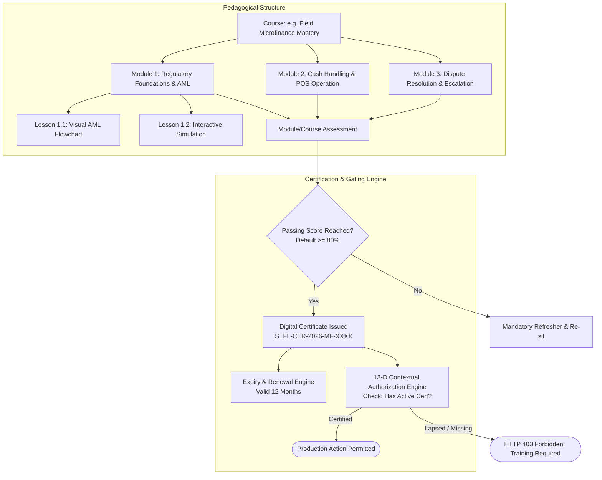

# STFL AIO — Training Certification & Authorization Gating Model

**System:** SohaelTasneem Foundation (STFL) Autonomous Enterprise Platform  
**Document Identity:** `STFL-DOC-2026-TRN-CER-V1`  
**Date:** 2026-10-15  
**Status:** SPECIFICATION — RATIFIED (SECTIONS 73, 80)  
**Security Level:** INTERNAL USE ONLY  

---

## 1. Executive Summary & Purpose

In mission-critical enterprise environments managing public funds, healthcare assets, legal land rights, and vulnerable beneficiary data, theoretical role assignment is insufficient. A user granted the role of "Microfinance Field Collector" or "Property Leasing Officer" must prove demonstrated operational and regulatory competence before being permitted to execute sensitive transactions in production.

The **STFL Training Certification & Authorization Gating Model** establishes a cryptographically verifiable certification ecosystem where:
1. Operational courses enforce structured mastery (`COURSE ➔ MODULE ➔ LESSON ➔ ASSESSMENT ➔ CERTIFICATE`).
2. Digital certificates are issued with cryptographic signatures, tamper-evident hashes, and explicit expiry windows.
3. The platform's **13-Dimensional Contextual Authorization Engine** evaluates `TRAINING_STATUS` as a hard prerequisite before granting access to high-risk APIs.
4. An automated recertification engine triggers renewal workflows on periodic expiry or when critical regulatory policies change.
5. An ethical **Training Analytics Engine** tracks systemic knowledge gaps and operational bottlenecks without being misused for punitive personnel actions.

---

## 2. Pedagogical Hierarchy & Assessment Architecture



### 2.1 Course Hierarchy Components
- **Course (`training_courses`)**: High-level certification target (e.g. `CRS-FIN-01: Microfinance Field Collection & Audit`).
- **Module (`training_modules`)**: Thematic pedagogical unit (e.g. `MOD-01: Anti-Money Laundering & KYC`).
- **Lesson (`training_lessons`)**: Discrete learning step containing pictorial guides, video demonstrations, and step-by-step checklists.
- **Assessment (`training_assessments`)**: Multi-modal evaluation consisting of:
  - Pictorial multiple-choice questions (randomized from approved pool).
  - Touch-based interactive screen simulations (e.g. "Identify the missing field in this loan application").
  - Practical checklist verification signed off by a supervisor or relief moderator.

---

## 3. Certification Authority & Cryptographic Verification

Upon achieving the required passing score (standard: 80%; high-risk compliance: 90%), the system issues an immutable digital certificate.

### 3.1 Digital Certificate Specification
- **Certificate Identity**: `STFL-CER-{YEAR}-{COURSE_CODE}-{SHORT_UUID}`.
- **Recipient Identity**: User ID, Verified Name, National ID hash, and Assigned Unit.
- **Jurisdiction & Project Scope**: Valid across STFL Global or restricted to specific Project UUIDs.
- **Cryptographic Signature**: ECDSA P-256 digital signature generated by the platform's Knowledge Certification Key.
- **Tamper-Evident SHA-256 Payload Hash**: Covers `(user_id, course_id, score, issued_at, expires_at)`.
- **QR Code Verification URL**: `https://stfl.foundation/verify/cert/{cert_id}` for instant field verification by auditors or supervisors.

### 3.2 Expiry, Renewal & Invalidation Lifecycles
- **Standard Expiry**: 365 days from issuance date.
- **Renewal Notification Ladder**:
  - `T-30 Days`: Friendly reminder in mobile dashboard and email.
  - `T-14 Days`: Yellow warning badge in operational workspaces.
  - `T-0 Days`: Certificate expires; `TRAINING_STATUS` transitions to `EXPIRED`.
- **Immediate Regulatory Invalidation (Section 71)**: If a statutory law or core STFL policy changes materially, the Knowledge Governance Officer can flag the course as `REGULATION_UPDATED`. All issued certificates enter `MANDATORY_REFRESHER` status with a 14-day grace window before authorization lock.

---

## 4. Training-Gated Authorization Integration (Section 73)

The STFL 13-D Contextual Authorization Engine natively incorporates `TRAINING_STATUS` evaluation.

### 4.1 Sensitive Operation Matrix & Training Prerequisite
| Action Code | Target Domain | Minimum User Class | Mandatory Certificate Code | Failure Behavior |
|---|---|---|---|---|
| `microfinance.collect` | Microfinance | Class 05 (Field) | `CERT-MF-COLL-01` | HTTP 403: Re-route to Training Portal |
| `microfinance.disburse`| Microfinance | Class 04 (Officer) | `CERT-MF-DISB-01` | HTTP 403: Supervisory Override Required |
| `property.lease_create`| Property | Class 04 (Officer) | `CERT-PROP-LEAS-01`| HTTP 403: Blocked; Draft saved only |
| `health.dispense_rx` | Health Project | Class 05 (Clinic) | `CERT-HLTH-PHARM-01`| HTTP 403: Strict Lockout |
| `procurement.tender` | Finance | Class 06 (Finance) | `CERT-FIN-PROC-01` | HTTP 403: Cannot publish RFP |

### 4.2 Middleware Enforcement Logic
```typescript
// Sample Hono Middleware Logic for Training Evaluation
async function enforceTrainingPrerequisite(c: Context, next: Next) {
  const user = c.get('user');
  const action = c.req.header('x-stfl-action');
  
  // 1. Lookup required certification for requested action
  const rule = await db.query.action_training_prerequisites.findFirst({
    where: eq(action_training_prerequisites.action_code, action)
  });

  if (rule && rule.is_mandatory) {
    // 2. Check user active certifications
    const cert = await db.query.training_user_certifications.findFirst({
      where: and(
        eq(training_user_certifications.user_id, user.id),
        eq(training_user_certifications.course_code, rule.required_course_code),
        eq(training_user_certifications.status, 'ACTIVE'),
        gt(training_user_certifications.expires_at, new Date())
      )
    });

    if (!cert) {
      // 3. Deny execution and redirect to learning center
      return c.json({
        error: "ACCESS_DENIED_TRAINING_PREREQUISITE_MISSING",
        message: `Action ${action} requires active certification: ${rule.required_course_code}`,
        remediation_url: `/learning/courses/${rule.required_course_code}`,
        current_training_status: cert ? cert.status : "UNENROLLED"
      }, 403);
    }
  }

  await next();
}
```

---

## 5. Training Analytics & Pedagogical Feedback Loop (Section 80)

To maintain educational effectiveness while strictly safeguarding staff welfare, the Training Analytics Engine operates under rigorous ethical and functional rules:

### 5.1 Tracked Operational Metrics
1. **Module Completion Rate**: Percentage of enrolled staff finishing lessons within expected timeframe.
2. **First-Time Assessment Pass Rate**: Indicator of lesson clarity versus assessment difficulty.
3. **Question Confusion Index**: High frequency of incorrect answers on specific questions reveals unclear visual guides or ambiguous SOP wording.
4. **Recertification Adherence**: Timely completion of annual refreshers across departments.
5. **Support Ticket Correlation**: Automated correlation between common operational errors in tickets (`moderator_work_queue`) and low assessment scores in related training modules.

### 5.2 Ethical Governance Guardrail
> **CONSTITUTIONAL RULE (Section 80)**:  
> *Training analytics data must be utilized exclusively for instructional improvement, curriculum refinement, and system usability optimization. Under no circumstances may raw training quiz scores or retry counts be utilized by supervisors for punitive personnel dismissals or disciplinary actions without independent, authorized governance review.*

---

## 6. PostgreSQL Schema: Training Certification & Prerequisite Rules

```sql
-- Training Certification Ledger
CREATE TABLE IF NOT EXISTS training_user_certifications (
    id                  UUID PRIMARY KEY DEFAULT gen_random_uuid(),
    certificate_number  TEXT NOT NULL UNIQUE,          -- e.g. STFL-CER-2026-MF-00841
    user_id             UUID NOT NULL REFERENCES users(id) ON DELETE CASCADE,
    course_id           UUID NOT NULL REFERENCES training_courses(id),
    course_code         TEXT NOT NULL,
    course_version      INTEGER NOT NULL,
    final_score_pct     NUMERIC(5,2) NOT NULL,
    issued_at           TIMESTAMPTZ NOT NULL DEFAULT now(),
    expires_at          TIMESTAMPTZ NOT NULL,
    status              TEXT NOT NULL CHECK (status IN ('ACTIVE', 'EXPIRING_SOON', 'EXPIRED', 'REVOKED', 'SUSPENDED')) DEFAULT 'ACTIVE',
    revocation_reason   TEXT,
    revoked_by          UUID REFERENCES users(id),
    signature_ecdsa     TEXT NOT NULL,                 -- Platform cryptographic signature
    provenance_hash     TEXT NOT NULL,                 -- SHA-256 (user_id, course_id, score, issued_at)
    created_at          TIMESTAMPTZ NOT NULL DEFAULT now(),
    updated_at          TIMESTAMPTZ NOT NULL DEFAULT now()
);

-- Action Training Prerequisites (Coupled to Authorization Engine)
CREATE TABLE IF NOT EXISTS action_training_prerequisites (
    id                  UUID PRIMARY KEY DEFAULT gen_random_uuid(),
    action_code         TEXT NOT NULL UNIQUE,          -- e.g. microfinance.collect, property.lease_create
    required_course_code TEXT NOT NULL,                -- e.g. CRS-MF-COLL-01
    minimum_score_pct   NUMERIC(5,2) NOT NULL DEFAULT 80.00,
    is_mandatory        BOOLEAN NOT NULL DEFAULT TRUE,
    applies_to_classes  JSONB NOT NULL DEFAULT '["CLASS_04", "CLASS_05"]'::jsonb,
    created_at          TIMESTAMPTZ NOT NULL DEFAULT now()
);

-- Training Analytics & Knowledge Gap Log
CREATE TABLE IF NOT EXISTS training_analytics_events (
    id                  UUID PRIMARY KEY DEFAULT gen_random_uuid(),
    course_id           UUID NOT NULL REFERENCES training_courses(id),
    module_id           UUID REFERENCES training_modules(id),
    user_id             UUID NOT NULL REFERENCES users(id),
    event_type          TEXT NOT NULL CHECK (event_type IN (
                          'LESSON_START', 'LESSON_COMPLETE', 'ASSESSMENT_PASS',
                          'ASSESSMENT_FAIL', 'SIMULATION_ERROR', 'CERT_RENEWED'
                        )),
    attempt_number      INTEGER NOT NULL DEFAULT 1,
    time_spent_seconds  INTEGER NOT NULL DEFAULT 0,
    confused_question_id TEXT,
    created_at          TIMESTAMPTZ NOT NULL DEFAULT now()
);

CREATE INDEX IF NOT EXISTS idx_trn_cert_user_active ON training_user_certifications(user_id, course_code, status) WHERE status = 'ACTIVE';
CREATE INDEX IF NOT EXISTS idx_action_trn_req ON action_training_prerequisites(action_code);
CREATE INDEX IF NOT EXISTS idx_trn_analytics_course ON training_analytics_events(course_id, event_type);
```

---

## 7. Summary of Certification Guarantees

1. **Certified Operations Only**: High-risk business actions cannot be executed by uncertified or lapsed operators.
2. **Cryptographic Verifiability**: Every certificate is digitally signed and verifiable in real-time online or offline via QR signature.
3. **Dynamic Regulatory Updates**: Legal changes automatically trigger targeted retraining rather than silent non-compliance.
4. **Data Protection & Staff Dignity**: Training metrics drive curriculum enhancement without enabling abusive automated personnel penalties.
