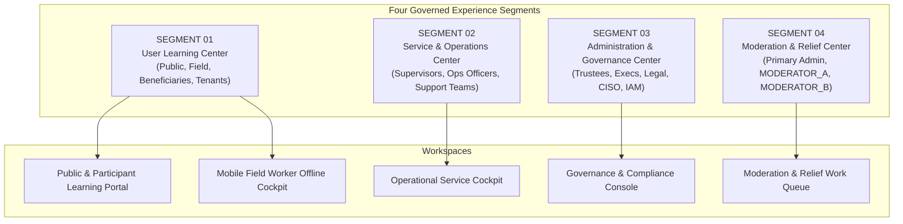

# STFL AIO — User Class, Workspace & Experience Segment Matrix

**System:** SohaelTasneem Foundation (STFL) Autonomous Enterprise Platform  
**Document Identity:** `STFL-DOC-2026-CLS-WRK-V1`  
**Date:** 2026-10-15  
**Status:** SPECIFICATION — RATIFIED (SECTIONS 64–68, 77, 81)  
**Security Level:** INTERNAL USE ONLY  

---

## 1. Executive Summary & Purpose

The STFL AIO Enterprise Platform operates across multi-tenant projects, complex legal jurisdictions, and a continuum of human and autonomous actors. To maintain zero-trust security and role clarity, the user interface and API surface are divided into **Four Experience Segments** and **18 Management Consoles**, accessed via dedicated role-tailored **Workspaces**.

This document unifies the **User Class Hierarchy (`CLASS_00` to `CLASS_12`)**, the **Administrative Relief Roles (`MODERATOR_A`, `MODERATOR_B`)**, and the **Four Experience Segments** into an authoritative server-enforced access and workspace allocation matrix.

---

## 2. Four Experience Segments Architecture (Sections 64–67)

The platform routes users upon authentication into one or more of four distinct Experience Segments:



### 2.1 Segment Breakdown
1. **Segment 01 — User Learning Center**: Visual tutorials, pictorial guides, step-by-step videos, interactive walkthroughs, safety certifications, and role-based onboarding for external and operational participants.
2. **Segment 02 — Service & Operations Center**: SOP library, operational manuals, troubleshooting runbooks, incident management, service status telemetry, and AI-assisted diagnostics.
3. **Segment 03 — Administration & Governance Center**: Governance procedures, IAM authorization, compliance guidelines, legal/regulatory intelligence, audit procedures, policy lifecycles, and cryptographic trust controls.
4. **Segment 04 — Moderation & Relief Center**: Work queue management, administrative relief, user assistance, ticket escalation, routine review, and knowledge curation under strictly capped authority.

---

## 3. User Class & Relief Role Definitions

| Actor / Class Code | Identity / Title | Attestation Required | Segment 01 (Learn) | Segment 02 (Service) | Segment 03 (Admin) | Segment 04 (Relief) |
|---|---|---|---|---|---|---|
| **Class 00** | Super Administrator | Tier 1 (Security Key) | Read | Full | Full | Oversight |
| **Class 01** | Board Trustee | Tier 1 (Biometric / Key) | Read | Oversight | Full (Gov) | Oversight |
| **Class 02** | Executive Director | Tier 1 (Enrolled Hardware)| Read | Manage | Manage | Oversight |
| **Class 03** | Unit / Project Head | Tier 2 (Hardware Token) | Read | Manage | Read (Unit) | Manage (Unit) |
| **Class 04** | Operational Officer | Tier 2 (Bound Workstation)| Certified | Operational | Limited | Assist |
| **Class 05** | Field Worker | Tier 3 (Bound Android) | Certified | Field Runbooks| — | — |
| **Class 06** | Finance Comptroller | Tier 1 (Enrolled Device) | Certified | Audit (Ledger)| Manage (Fin) | Review (Fin) |
| **Class 07** | Security & Audit Officer| Tier 1 (Hardware Key) | Certified | Audit (Sec) | Manage (Sec) | Audit (Logs) |
| **Class 08** | Document Officer | Tier 2 (Bound Workstation)| Certified | SOP Library | Limited | Document Q |
| **Class 09** | HR & Workforce Lead | Tier 2 (Enrolled Device) | Certified | Onboarding | Limited | Staff Q |
| **Class 10** | Autonomous AI Agent | Software Credential | Read-Only | Diagnostic | Task Tools | Self-Report |
| **Class 11** | External Stakeholder | Browser MFA | Enrolled | — | — | Ticket User |
| **Class 12** | Public / Beneficiary | Web Session / SMS OTP | Enrolled | Status View | — | Inbound Q |
| **MODERATOR_A** | Operational Relief Mod | Tier 2 (Enrolled Device) | Tutor/Review| Support Desk | — | **FULL (Q-A)** |
| **MODERATOR_B** | Technical/Gov Relief Mod| Tier 2 (Enrolled Device) | Curator | Triage/SOP | Limited | **FULL (Q-B)** |

---

## 4. Master 18-Console Access Matrix (Incorporating Consoles 17 & 18)

| Console Name | Class 00 (Admin) | Class 01 (Trustee) | Class 02 (Exec) | Class 03 (Lead) | Class 04 (Officer) | Class 05 (Field) | Class 06 (Finance) | Class 07 (Security) | MOD_A (Relief) | MOD_B (Relief) | Class 10 (AI) | Class 11/12 (Public) |
|---|---|---|---|---|---|---|---|---|---|---|---|---|
| **1. Governance** | Limited | **FULL** | Manage | Read | — | — | Read | Oversight | — | Read | — | — |
| **2. Executive** | Oversight | Oversight | **FULL** | Read | — | — | Read | Oversight | — | Read | Read | — |
| **3. Finance** | Limited\* | Oversight | Manage | Manage\* | Operational | Limited | **FULL** | Audit | Read Q | Read Q | Task Tools | Self (Receipts) |
| **4. Property** | — | Oversight | Manage | **FULL** | Operational | Field | Read | — | Ticket Q | — | Task Tools | Self (Tenant) |
| **5. Microfinance**| — | Oversight | Manage | **FULL** | Operational | Field (Col) | Read | — | Ticket Q | — | Task Tools | Self (Borrower) |
| **6. Workforce** | — | Oversight | Manage | Manage | Operational | Self | Read | — | Ticket Q | Review | Task Tools | Self (Applicant)|
| **7. E-Commerce** | — | Oversight | Manage | **FULL** | Operational | Field (Del) | Read | — | Ticket Q | — | Task Tools | Self (Customer) |
| **8. Projects** | — | Oversight | Manage | **FULL** | Operational | Field (Surv)| Read | — | Ticket Q | Review | Task Tools | Self (Partner) |
| **9. Asset Mgmt** | Limited | Oversight | Manage | Manage | Operational | Field (Aud) | Read | — | Ticket Q | — | Task Tools | — |
| **10. Documents** | — | Oversight | Manage | Manage | Operational | — | Read | Audit | Assist | Review | Draft Tools | Verify / Self |
| **11. Comms** | Limited | Oversight | Manage | Manage | Operational | — | Read | Audit | Inbound Q | Inbound Q | Tpl Tools | Inbound / SMS |
| **12. Security** | Limited\* | Oversight | Oversight | Read | Own Events | Own Events | Read | **FULL** | Audit | Audit | Logged | — |
| **13. Agent Ctrl** | Manage | Oversight | Manage | Manage | — | — | — | **FULL** | Monitor | Monitor | Heartbeat | — |
| **14. Device Mgmt**| Manage | Oversight | — | Read | — | Self Bind | — | **FULL** | Assist Q | Review Q | — | — |
| **15. IAM** | **FULL** | Oversight | Manage | Read | — | — | — | Oversight | Reset Q | Audit Q | — | — |
| **16. System Admin**| **FULL**| — | — | — | — | — | — | Audit | — | — | — | — |
| **17. Compliance** | Limited | Oversight | Manage | Manage | Operational | — | Audit | Oversight | Referral | Review | Audit Tools | Public Rules |
| **18. Knowledge** | Manage | Oversight | Manage | Manage | Certified | Certified | Manage(Fin)| Manage(Sec)| **FULL (Ops)**| **FULL (Gov)**| Diagnostic | Learning Ctr |

`*` Sensitive Gating & Separation of Duties Invariants:
- `MODERATOR_A` and `MODERATOR_B` hold `FULL` management over Console 18 queues, but have zero authority in Console 16 (System Admin) and zero financial ledger write rights in Console 3.
- `MODERATOR_A` focuses on queue items: `USER_HELP`, `ACCOUNT_SUPPORT`, `TRAINING_REVIEW`, `DOCUMENT_SUPPORT`.
- `MODERATOR_B` focuses on queue items: `CONTENT_REVIEW`, `KNOWLEDGE_UPDATE`, `TECHNICAL_SUPPORT`, `COMPLIANCE_REFERRAL`, `ESCALATION`.
- Neither moderator may approve their own initiated requests or certify their own training assessments.

---

## 5. Server-Side Policy Schema Integration

The dynamic policy table in PostgreSQL evaluates access across both classes and relief moderator assignments:

```sql
-- Extended IAM Dynamic Console Policy Table
CREATE TABLE IF NOT EXISTS iam_workspace_policies (
    id                   UUID PRIMARY KEY DEFAULT gen_random_uuid(),
    console_code         TEXT NOT NULL,                 -- e.g. KNOWLEDGE_CONSOLE, MODERATOR_QUEUE
    experience_segment   TEXT NOT NULL CHECK (experience_segment IN (
                           'SEGMENT_01_LEARN', 'SEGMENT_02_SERVICE',
                           'SEGMENT_03_ADMIN', 'SEGMENT_04_RELIEF'
                         )),
    user_class           TEXT NOT NULL,                 -- CLASS_00..CLASS_12 or MODERATOR_A, MODERATOR_B
    access_level         TEXT NOT NULL CHECK (access_level IN (
                           'FULL', 'MANAGE', 'OVERSIGHT', 'OPERATIONAL',
                           'FIELD', 'LIMITED', 'CERTIFIED', 'REVIEW', 'DENIED'
                         )),
    conditions_json      JSONB NOT NULL DEFAULT '{}'::jsonb,
    is_active            BOOLEAN NOT NULL DEFAULT TRUE,
    created_at           TIMESTAMPTZ NOT NULL DEFAULT now(),
    CONSTRAINT unq_workspace_policy UNIQUE (console_code, user_class, experience_segment)
);
```

---

## 6. Summary of Workspace Guarantees

1. **Role-Tailored Cockpits**: Users are presented only with the tools, learning guides, and queues relevant to their verified class and scope.
2. **Ironclad Administrative Relief**: Relief moderators manage operational throughput without possessing root or financial disbursement authority.
3. **Universal Learning Center**: Public users and field workers have full access to interactive educational modules without administrative clutter.
4. **Dynamic Middleware Enforcement**: Access rules are validated in backend middleware via database-backed policy lookup on every request.
