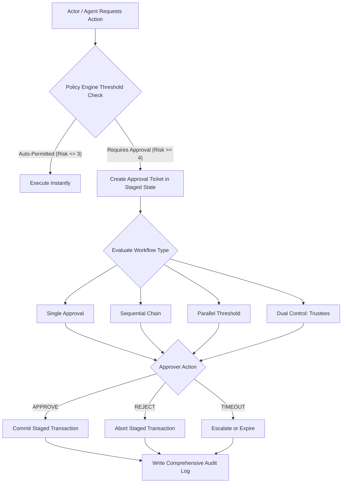

# STFL AIO — Policy-Driven Approval Engine Specification

**System:** SohaelTasneem Foundation (STFL) Autonomous Enterprise Platform  
**Document Identity:** `STFL-DOC-2026-APP-ENG-V1`  
**Date:** 2026-10-15  
**Status:** SPECIFICATION — RATIFIED (PHASE 0B)  
**Security Level:** RESTRICTED

---

## 1. Approval Engine Architecture

In STFL AIO, sensitive actions do not complete synchronously if they cross predefined policy thresholds. The system intercepts the request, stages the uncommitted state, and initializes an **Approval Ticket** inside the policy engine.



---

## 2. Supported Approval Workflow Patterns

1. **Single Approval**: One designated manager sign-off (e.g. Field expense voucher approved by Operations Officer).
2. **Sequential Multi-Tier Approval**: Step 1 must complete before Step 2 begins (e.g. Finance Officer $\rightarrow$ Finance Head $\rightarrow$ Trustee).
3. **Parallel Threshold Approval**: Requires $M$ of $N$ authorized approvers (e.g. Emergency relief dispatch requiring 2 of 3 designated Agency Directors).
4. **Monetary Threshold Routing**:
   * $\le \text{5,000 BDT}$: Auto-approved under verified policy.
   * $\text{5,001} - \text{25,000 BDT}$: Single approval by Unit Head.
   * $\text{25,001} - \text{100,000 BDT}$: Two-stage approval (Unit Head + Executive Director).
   * $> \text{100,000 BDT}$ or Asset Disposals: Mandatory Level 5 Dual Control (Two independent Trustees).
5. **Temporary Operational Delegation**: A Unit Head on medical/field leave delegates approval authority to an Acting Head with an explicit expiration timestamp.
6. **Emergency Override Approval**: Special expedited protocol for natural disasters; requires immediate cryptographic notification to all Trustees.

---

## 3. Database Schema for Approval Workflows

```sql
CREATE TABLE IF NOT EXISTS approval_policies (
    id                   UUID PRIMARY KEY DEFAULT gen_random_uuid(),
    policy_code          TEXT NOT NULL UNIQUE,          -- POL-MF-LOAN-DISBURSE-V1
    title                TEXT NOT NULL,
    action_type          TEXT NOT NULL,                 -- e.g. loan.disburse, payment.release, lease.approve
    unit_code            TEXT NOT NULL,
    workflow_type        TEXT NOT NULL CHECK (workflow_type IN (
                           'SINGLE', 'SEQUENTIAL', 'PARALLEL_THRESHOLD', 'DUAL_CONTROL'
                         )),
    min_approvals_needed SMALLINT NOT NULL DEFAULT 1,
    threshold_amount     NUMERIC(18, 2),                -- Monetary trigger ceiling
    steps_json           JSONB NOT NULL DEFAULT '[]'::jsonb, -- Configured approval tiers
    expires_after_hours  INTEGER NOT NULL DEFAULT 48,
    is_active            BOOLEAN NOT NULL DEFAULT TRUE,
    created_at           TIMESTAMPTZ NOT NULL DEFAULT now()
);

CREATE TABLE IF NOT EXISTS approval_tickets (
    id                   UUID PRIMARY KEY DEFAULT gen_random_uuid(),
    ticket_id            TEXT NOT NULL UNIQUE,          -- STFL-APP-2026-000492
    policy_id            UUID NOT NULL REFERENCES approval_policies(id),
    initiator_id         UUID NOT NULL REFERENCES users(id),
    initiator_device_id  TEXT NOT NULL,
    target_resource_type TEXT NOT NULL,                 -- loan, payment_voucher, lease, document
    target_resource_id   TEXT NOT NULL,                 -- ID of staged entity
    staged_payload_json  JSONB NOT NULL,                -- Exact payload awaiting commitment
    current_step         SMALLINT NOT NULL DEFAULT 1,
    status               TEXT NOT NULL DEFAULT 'PENDING'
                         CHECK (status IN ('PENDING', 'APPROVED', 'REJECTED', 'EXPIRED', 'CANCELLED')),
    expires_at           TIMESTAMPTZ NOT NULL,
    finalized_at         TIMESTAMPTZ,
    created_at           TIMESTAMPTZ NOT NULL DEFAULT now()
);

CREATE INDEX IF NOT EXISTS idx_approval_tickets_status ON approval_tickets (status);
CREATE INDEX IF NOT EXISTS idx_approval_tickets_resource ON approval_tickets (target_resource_type, target_resource_id);

CREATE TABLE IF NOT EXISTS approval_decisions (
    id                   UUID PRIMARY KEY DEFAULT gen_random_uuid(),
    ticket_id            UUID NOT NULL REFERENCES approval_tickets(id) ON DELETE CASCADE,
    approver_id          UUID NOT NULL REFERENCES users(id),
    step_number          SMALLINT NOT NULL,
    decision             TEXT NOT NULL CHECK (decision IN ('APPROVE', 'REJECT', 'ESCALATE', 'REQUEST_INFO')),
    comments             TEXT,
    device_id            TEXT NOT NULL,
    ip_hash              TEXT,
    decided_at           TIMESTAMPTZ NOT NULL DEFAULT now(),
    -- Anti-Collusion Invariant: Initiator cannot approve their own ticket
    CONSTRAINT approver_not_initiator CHECK (approver_id IS NOT NULL)
);

CREATE INDEX IF NOT EXISTS idx_approval_decisions_ticket ON approval_decisions (ticket_id);
```

---

## 4. Anti-Collusion Enforcement Logic

To ensure the separation of duties principle is mathematically inviolable:
```sql
CREATE OR REPLACE FUNCTION check_approval_collusion()
RETURNS TRIGGER AS $$
DECLARE
    ticket_initiator UUID;
BEGIN
    SELECT initiator_id INTO ticket_initiator FROM approval_tickets WHERE id = NEW.ticket_id;
    
    IF NEW.approver_id = ticket_initiator THEN
        RAISE EXCEPTION 'Separation of Duties Breach: Initiator % cannot approve their own ticket %', 
            NEW.approver_id, NEW.ticket_id;
    END IF;
    
    RETURN NEW;
END;
$$ LANGUAGE plpgsql;

CREATE TRIGGER trg_prevent_approval_collusion
BEFORE INSERT ON approval_decisions
FOR EACH ROW
EXECUTE FUNCTION check_approval_collusion();
```
This guarantees that even if a frontend or API client were compromised, PostgreSQL itself enforces separation of duties and rejects self-approval transactions.
