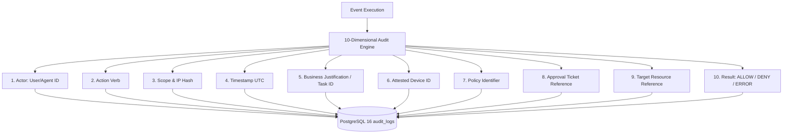

# STFL AIO — 10-Dimensional Institutional Audit Model

**System:** SohaelTasneem Foundation (STFL) Autonomous Enterprise Platform  
**Document Identity:** `STFL-DOC-2026-AUDIT-V1`  
**Date:** 2026-10-15  
**Status:** SPECIFICATION — RATIFIED (PHASE 0)  
**Security Level:** RESTRICTED

---

## 1. The 10-Dimensional Audit Question

Every sensitive or operational action on the STFL platform must write an immutable audit log answering the **10 Institutional Questions**:

```text
1. WHO                   The human user (STFL-USR-*) or AI agent (STFL-AGT-*) acting.
2. WHAT                  The exact operational verb (e.g. RECEIPT_ISSUE, LEASE_APPROVE).
3. WHERE                 The operational scope and IP hash where the event originated.
4. WHEN                  The exact millisecond-accurate ISO timestamp (UTC).
5. WHY                   The business justification, task reference, or policy trigger.
6. WITH WHICH DEVICE     The attested hardware device identifier (STFL-DVC-*).
7. UNDER WHICH POLICY    The governing unit policy code (e.g. POL-MF-COLLECT-03).
8. WITH WHICH APPROVAL   The approval ticket (STFL-APP-*) or AUTO_PERMITTED designation.
9. AGAINST WHICH RESOURCE The specific entity, contract, or ledger row affected.
10. RESULT               SUCCESS, DENIED, or FAILED.
```



---

## 2. Complete Audit Schema Specification

Building upon the baseline `audit_logs` table in `0001_init.sql`, the schema is extended additively:

```sql
CREATE TABLE IF NOT EXISTS enterprise_audit_logs (
    id                   BIGSERIAL PRIMARY KEY,
    audit_uuid           UUID NOT NULL UNIQUE DEFAULT gen_random_uuid(),
    actor_type           TEXT NOT NULL CHECK (actor_type IN ('USER', 'AGENT', 'SYSTEM')),
    actor_id             TEXT NOT NULL,                 -- STFL-USR-00421 or STFL-AGT-FIN-001
    actor_relationship   TEXT,                          -- e.g. MICROFINANCE_COLLECTION_OFFICER
    user_class           TEXT,                          -- CLASS_05
    action               TEXT NOT NULL,                 -- RECEIPT_ISSUE, LEASE_APPROVE, etc.
    resource_type        TEXT NOT NULL,                 -- loan, lease, document, payment
    resource_id          TEXT NOT NULL,                 -- Canonical resource identifier
    scope_code           TEXT,                          -- SCP-REG-DHK-NORTH-01
    device_id            TEXT,                          -- STFL-DVC-8F31A2
    ip_hash              TEXT,                          -- SHA-256 of client IP
    policy_code          TEXT NOT NULL,                 -- Governing policy
    approval_ref         TEXT NOT NULL DEFAULT 'AUTO_PERMITTED', -- STFL-APP-* or AUTO_PERMITTED
    before_state_hash    TEXT,                          -- SHA-256 of row before mutation
    after_state_hash     TEXT,                          -- SHA-256 of row after mutation
    result               TEXT NOT NULL CHECK (result IN ('SUCCESS', 'DENIED', 'ERROR', 'ESCALATED')),
    error_code           TEXT,
    metadata             JSONB NOT NULL DEFAULT '{}'::jsonb,
    created_at           TIMESTAMPTZ NOT NULL DEFAULT now()
);

CREATE INDEX IF NOT EXISTS idx_ent_audit_actor ON enterprise_audit_logs (actor_id, created_at DESC);
CREATE INDEX IF NOT EXISTS idx_ent_audit_resource ON enterprise_audit_logs (resource_type, resource_id);
CREATE INDEX IF NOT EXISTS idx_ent_audit_action ON enterprise_audit_logs (action, created_at DESC);
CREATE INDEX IF NOT EXISTS idx_ent_audit_device ON enterprise_audit_logs (device_id) WHERE device_id IS NOT NULL;
```

---

## 3. Real-World Audit Entry Examples

### Example 1: Doorstep Microfinance Collection Receipt
```json
{
  "auditUuid": "7a8b9c0d-1e2f-4a5b-8c9d-0e1f2a3b4c5d",
  "who": "STFL-USR-00421",
  "actorType": "USER",
  "actorRelationship": "MICROFINANCE_COLLECTION_OFFICER",
  "userClass": "CLASS_05",
  "what": "RECEIPT_ISSUE",
  "where": "SCP-REG-DHK-NORTH-02 (IP Hash: e3b0c44298fc...)",
  "when": "2026-10-15T07:42:19.412Z",
  "why": "Daily route installment collection for group North-B",
  "withWhichDevice": "STFL-DVC-8F31A2",
  "underWhichPolicy": "POL-MF-COLLECT-03",
  "withWhichApproval": "AUTO_PERMITTED",
  "againstWhichResource": "STFL-TXN-2026-000023-R4Q9",
  "result": "SUCCESS"
}
```

### Example 2: Autonomous Agent Financial Voucher Draft
```json
{
  "auditUuid": "1f2e3d4c-5b6a-7a8b-9c0d-1e2f3a4b5c6d",
  "who": "STFL-AGT-FIN-001",
  "actorType": "AGENT",
  "actorRelationship": "FINANCE_RECONCILIATION_AGENT",
  "userClass": "CLASS_10",
  "what": "VOUCHER_DRAFT",
  "where": "GLOBAL (Cloudflare Worker Edge Pool)",
  "when": "2026-10-15T07:45:00.108Z",
  "why": "Automated matching of Bank Statement deposit to donor donation",
  "withWhichDevice": "STFL-SERVER-WORKER-01",
  "underWhichPolicy": "POL-FIN-AUTO-MATCH-01",
  "withWhichApproval": "AUTO_PERMITTED",
  "againstWhichResource": "STFL-VCH-2026-000104",
  "result": "SUCCESS"
}
```

---

## 4. Absolute Data Minimization & Privacy Rules

To comply with international privacy standards and safeguarding directives:
1. **Never Log Passwords or PINs**: Password fields are redacted before logging.
2. **Never Log JWT Access Tokens or Refresh Tokens**: Tokens are hashed or completely excluded.
3. **Never Log Private Cryptographic Keys**: AndroidKeyStore private keys never leave the Secure Element.
4. **Never Log Beneficiary Bank Account Numbers or National IDs in Plaintext**: All identity credentials are cryptographically hashed using SHA-256.
5. **Immutable Records**: The `enterprise_audit_logs` table has all `UPDATE` and `DELETE` grants revoked from standard API database users; rows are append-only.
