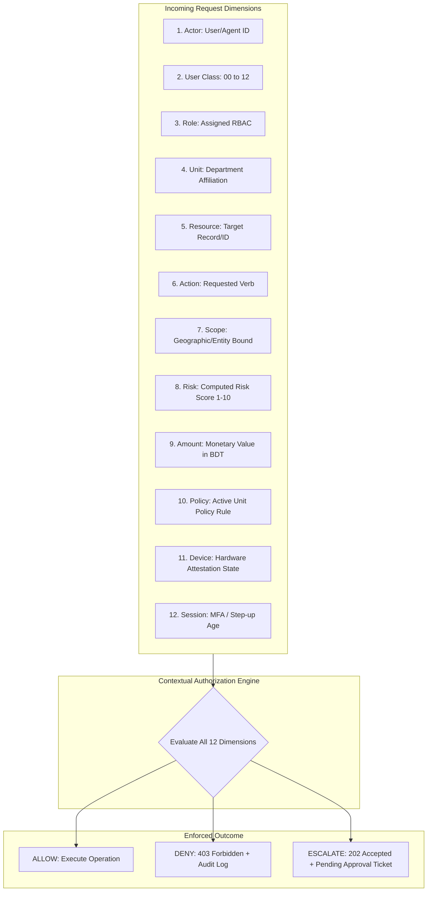

# STFL AIO — Contextual Authorization Engine Specification

**System:** SohaelTasneem Foundation (STFL) Autonomous Enterprise Platform  
**Document Identity:** `STFL-DOC-2026-AUTH-ENGINE-V1`  
**Date:** 2026-10-15  
**Status:** SPECIFICATION — RATIFIED (PHASE 0B)  
**Security Level:** RESTRICTED

---

## 1. Multi-Dimensional Contextual Authorization Philosophy

STFL AIO enforces contextual authorization. A user possessing the role `FINANCE_OFFICER` does not have blanket permission to disburse funds. 

Authorization evaluates a 12-dimensional vector in real-time on every authenticated request:

$$\mathbf{AuthorizationDecision} = \mathcal{E}\left( \mathbf{Actor}, \mathbf{Class}, \mathbf{Role}, \mathbf{Unit}, \mathbf{Resource}, \mathbf{Action}, \mathbf{Scope}, \mathbf{Risk}, \mathbf{Amount}, \mathbf{Policy}, \mathbf{DeviceState}, \mathbf{Session} \right)$$



---

## 2. Dimensional Definitions & Threshold Rules

| Dimension | Evaluation Criteria | Enforcement Rule |
|---|---|---|
| **1. Actor** | Is caller a verified Human User Account or an Autonomous System Agent? | AI Agents cannot masquerade as human users (`actor_type = 'agent'`). |
| **2. User Class** | Which of the 13 classes does the actor belong to? | Classes dictate console access and maximum authority bounds. |
| **3. Role** | What RBAC role is assigned to the actor? | Role provides the base permission strings (e.g. `property.write`). |
| **4. Unit** | What operational unit does the actor belong to? | Operations outside the actor's unit are blocked unless Global scope is held. |
| **5. Resource** | What target entity is being accessed? | Resource ownership and relationship links are cross-referenced in DB. |
| **6. Action** | What specific operation is requested? | Actions mapped to Level 0 (Read) through Level 5 (Dual Control). |
| **7. Scope** | What operational boundary is bound to this actor? | Target resource must reside within actor's geographical or property scope. |
| **8. Risk Score** | What is the algorithmic risk level (1 to 10)? | Risk $\ge 7$ triggers mandatory step-up authentication or human escalation. |
| **9. Amount Limit** | What is the monetary transaction value? | Amounts exceeding role limits automatically create approval tickets. |
| **10. Policy** | What specific unit governance rule governs this flow? | Unit policy overrides default role permissions when conflicts arise. |
| **11. Device State** | Is the caller's mobile device `ACTIVE` and hardware-attested? | Access to non-public endpoints is denied if device is `PENDING` or `REVOKED`. |
| **12. Session Context** | How old is the authentication; is step-up MFA verified? | High-risk actions require authentication fresh within 15 minutes. |

---

## 3. Concrete Authorization Evaluation Scenarios

### Scenario A: Microfinance Collection Officer Collecting Doorstep Cash
```text
Actor: STFL-USR-00421
Class: CLASS_05 (Field Worker)
Role: MICROFINANCE_COLLECTION_OFFICER
Unit: MICROFINANCE
Resource: STFL-LON-2026-000089 (Loan Record)
Action: collection.record
Scope: REGION-DHAKA-NORTH-02
Risk Score: 2 (Normal)
Amount: 1,500.00 BDT
Device State: ACTIVE (Hardware Attested Android KeyStore)
Session: Valid Bearer JWT

EVALUATION:
1. Actor has role 'MICROFINANCE_COLLECTION_OFFICER' which includes 'collection.record' -> PASS
2. Target loan borrower resides in 'REGION-DHAKA-NORTH-02' matching actor scope -> PASS
3. Amount (1,500 BDT) is within daily field collection ceiling (10,000 BDT) -> PASS
4. Device is ACTIVE and attested -> PASS

OUTCOME: ALLOW (Execute cash collection, issue receipt STFL-RCP-*, write audit log).
```

### Scenario B: Field Worker Attempting to Approve a Loan Disbursement
```text
Actor: STFL-USR-00421
Class: CLASS_05 (Field Worker)
Role: MICROFINANCE_COLLECTION_OFFICER
Action: loan.approve
Resource: STFL-LON-2026-000095

EVALUATION:
1. Action 'loan.approve' is classified as Level 4 Authority.
2. Class 05 (Field Worker) is strictly bounded to Level 3 Authority maximum.
3. Role lacks 'loan.approve' permission string.

OUTCOME: DENY (403 Forbidden. Emits audit log with action='security.unauthorized_attempt').
```

### Scenario C: Finance Officer Initiating a High-Value Supplier Payment
```text
Actor: STFL-USR-00088
Class: CLASS_06 (Finance Specialist)
Role: FINANCE_OFFICER
Action: payment.disburse
Amount: 75,000.00 BDT
Unit: FINANCE

EVALUATION:
1. Role includes 'payment.prepare' and 'payment.submit'.
2. Amount (75,000 BDT) exceeds Officer single-disbursement limit (10,000 BDT).
3. Action classified as Level 4 Authority (Human Approval Required).

OUTCOME: ESCALATE (202 Accepted. Creates pending approval ticket in approval chain:
Step 1: Finance Head approval required; Step 2: Trustee dual-control sign-off required).
```
