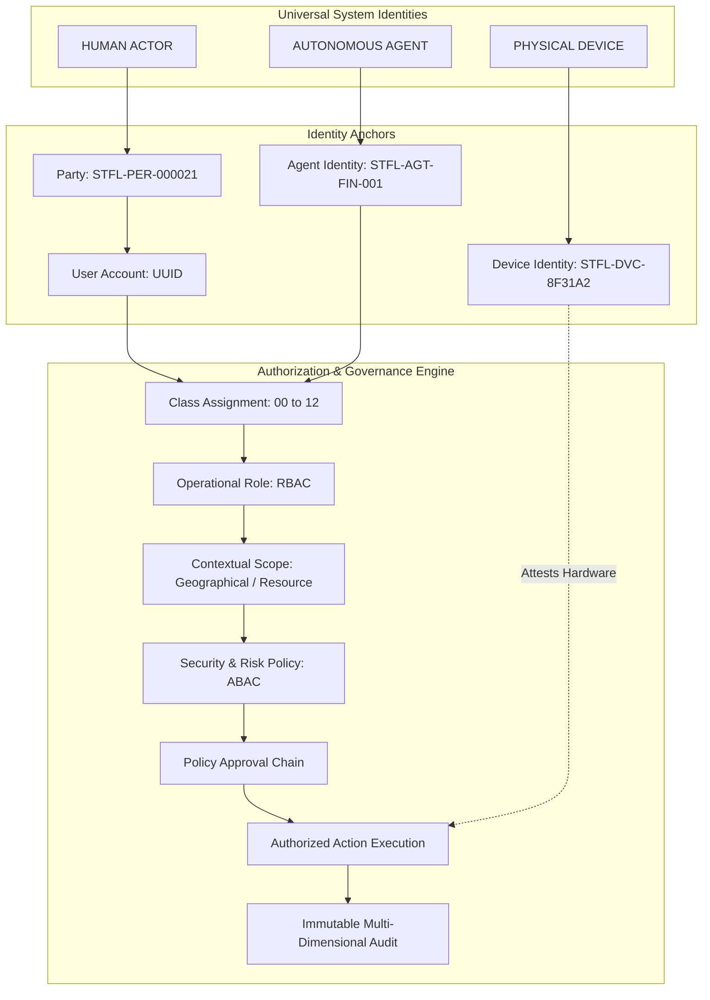
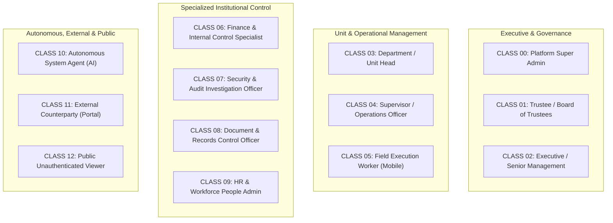
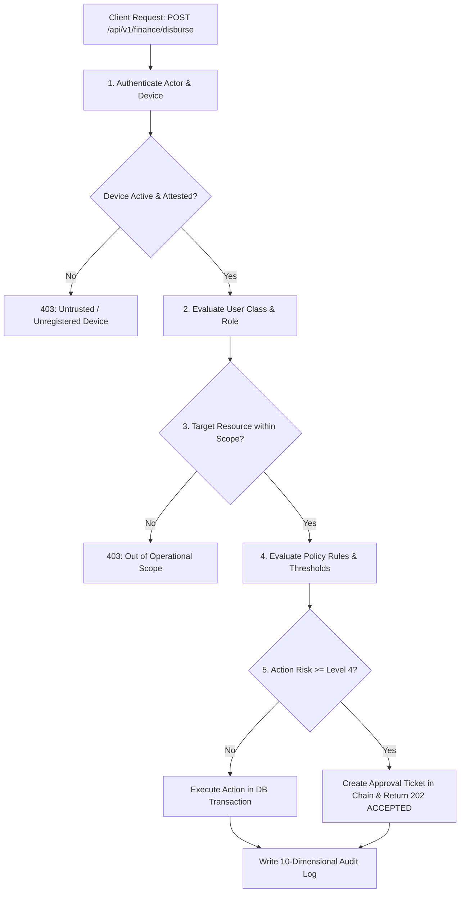

# STFL AIO — Identity, Access & User Class Architecture (IAM)

**System:** SohaelTasneem Foundation (STFL) Autonomous Enterprise Platform  
**Document Identity:** `STFL-DOC-2026-IAM-V1`  
**Date:** 2026-10-15  
**Status:** ARCHITECTURAL SPECIFICATION — RATIFIED (PHASE 0B)  
**Security Level:** RESTRICTED

---

## 1. Unified Identity Grammar: Human, Agent, Device

STFL AIO unifies three fundamentally different system entities under one cohesive governance model. AI agents and physical devices are first-class system actors, not subordinate attributes of human accounts.



---

## 2. The 13 System & User Classes (Classes 00 to 12)

Every authenticated actor in STFL AIO belongs to an explicit **User Class** that dictates baseline trust boundaries, permitted consoles, authentication factors, and session lifetimes.



### Class Specifications & Target Consoles

| Class Code | Class Name | Primary Backend / Interface | Permitted Core Responsibilities | Invariants & Guardrails |
|---|---|---|---|---|
| **CLASS 00** | **PLATFORM SUPER ADMIN** | `STFL SYSTEM CONTROL CENTER` | Infrastructure, DB migrations, emergency controls, role/permission catalogue, tenant configs. | **Anti-Fraud Invariant**: Cannot approve their own financial disbursements or modify business records. |
| **CLASS 01** | **TRUSTEE / BOARD** | `STFL GOVERNANCE CONSOLE` | Strategic oversight, financial audit review, statutory resolutions, Level 5 dual-control approvals. | Read-all governance; approval authority over major fund movements (> 50,000 BDT) and asset disposals. |
| **CLASS 02** | **EXECUTIVE / MANAGEMENT** | `STFL EXECUTIVE COMMAND CENTER` | Organization-wide operational coordination, budget sign-off, agency project authorizations. | Comprehensive cross-unit reporting; Level 4 approval authority for major contracts. |
| **CLASS 03** | **UNIT HEAD** | `STFL UNIT MANAGEMENT CONSOLE` | Unit staff scheduling, unit task delegation, unit agent parameter tuning, department approvals. | Scoped strictly to assigned operational department (e.g. Finance Head cannot approve Leases). |
| **CLASS 04** | **SUPERVISOR / OFFICER** | `STFL OPERATIONS CONSOLE` | Review field submissions, approve field expense vouchers, monitor daily queues, task dispatch. | Operational authority over assigned field workers; cannot alter baseline unit policies. |
| **CLASS 05** | **FIELD WORKER** | `STFL ANDROID FIELD APP` | Doorstep microfinance collection, property inspection, aid distribution, offline duty logs. | **Console Isolation**: Admin web console is blocked. Bound to verified mobile device via `FLAG_SECURE`. |
| **CLASS 06** | **FINANCE CONTROL SPECIALIST** | `STFL FINANCE CONTROL CENTER` | Bank reconciliation, chart of accounts management, payment voucher preparation, donor fund audits. | **Separation of Duties**: Preparer cannot execute final release of funds. |
| **CLASS 07** | **SECURITY & AUDIT OFFICER** | `STFL SECURITY & AUDIT CENTER` | Device approvals/revocations, print token audit, incident forensics, agent kill switches, IP blocks. | Zero financial or commercial operational authority; pure enforcement and audit power. |
| **CLASS 08** | **DOCUMENT / RECORDS OFFICER** | `STFL DOCUMENT CONTROL CENTER` | Official template registration, digital document revocation, public verification portal management. | Oversees document immutability; cannot unilaterally issue deeds without signed source contracts. |
| **CLASS 09** | **HR / PEOPLE ADMIN** | `STFL WORKFORCE CENTER` | Employee records, duty roasters, leave requests, biometric enrollment oversight, payroll drafts. | Manages worker profiles; payroll disbursements must be countersigned by Finance (Class 06). |
| **CLASS 10** | **SYSTEM AGENT (AI)** | `STFL AGENT CONTROL CENTER` | Continuous reconciliation, risk scoring, route optimization, low-stock warnings, draft notices. | **Non-Masquerade Invariant**: Must sign with `STFL-AGT-*`. Level 4/5 actions automatically halt for human approval. |
| **CLASS 11** | **EXTERNAL PARTY** | `STFL EXTERNAL PORTAL` | Donors viewing receipts; borrowers viewing repayment schedules; tenants viewing rent invoices. | Strictly scoped to records where Party ID matches caller; zero administrative access. |
| **CLASS 12** | **PUBLIC / VERIFICATION USER** | `https://stflbd.app/verify/*` | Verify digital document authenticity via QR code or verification slug. | Zero account required. Zero PII, internal notes, or financial account data emitted. |

---

## 3. First-Class Scope Model

Scope restricts authority to an exact organizational, geographic, or resource-level boundary:

$$\mathbf{EffectiveAuthority} = \text{Action} \cap \text{Resource} \cap \mathbf{Scope} \cap \text{Policy}$$

### Supported Scope Types
```text
GLOBAL                  Unrestricted across all foundation units (Super Admin / Trustees only)
ORGANIZATION            Bound to specific legal subsidiary or trust (e.g. STFL Health vs STFL Craft)
UNIT                    Bound to operational department (e.g. Microfinance Unit, Property Unit)
REGION                  Geographical boundary (e.g. Dhaka North Division, Sylhet Flood Relief Zone)
PROJECT                 Bound to specific humanitarian campaign (e.g. Winter Clothes Drive 2026)
PROPERTY                Bound to specific physical building or Waqf estate (e.g. STFL-PRP-DHK-0001)
PORTFOLIO               Bound to group of loans, commercial leases, or relief funds
ASSIGNED_RECORD         Restricted exclusively to records where the user is assigned officer
```

### Scope Enforcement Example
```text
Officer Farhan (STFL-USR-00109)
Class: SUPERVISOR_OFFICER (Class 04)
Role: PROPERTY_OFFICER
Unit: PROPERTY_MANAGEMENT
Scope: PROPERTY (STFL-PRP-DHK-0001)

Evaluation:
- Attempts to inspect Unit 4A of STFL-PRP-DHK-0001: ALLOWED (Within Scope)
- Attempts to inspect Unit 2B of STFL-PRP-SYL-0004: DENIED 403 (Scope Boundary Violation)
```

---

## 4. Multi-Dimensional Contextual Authorization Engine

Authorization in STFL AIO does not simply test `if (user.role === 'admin')`. The authorization decision engine evaluates 12 contextual dimensions in real time:

$$\mathbf{AuthorizationDecision} = f\left(\begin{aligned}
& \text{Actor Identity (User/Agent)}, \text{User Class}, \text{Assigned Role}, \\
& \text{Unit}, \text{Target Resource}, \text{Requested Action}, \\
& \text{Operational Scope}, \text{Transaction Risk Score}, \text{Amount Limit}, \\
& \text{Governing Policy}, \text{Device Attestation State}, \text{Session Context}
\end{aligned}\right)$$



---

## 5. Separation of Duties (Anti-Collusion Invariants)

To protect non-profit and public trust assets against embezzlement or unilateral abuse, the platform enforces hard separation of duties across all financial, property, and microfinance operations:

1. **The Three-Way Rule**: No single user or agent may:
   $$\mathbf{Create} + \mathbf{Approve} + \mathbf{Disburse}$$
   the same transaction. A voucher created by a Finance Officer (Class 04/06) must be approved by the Finance Head (Class 03) and released by an independent Trustee or Bank Signatory (Class 01/02).
2. **Loan Underwriting Separation**: The field officer who visits a microfinance applicant cannot approve the loan origination; approval rests with the Microfinance Unit Head.
3. **Lease Signatory Separation**: A property manager cannot sign a lease as both Lessor and Lessee representative.
4. **Agent Self-Execution Prohibition**: AI agents generating payment proposals or loan forgiveness schedules cannot approve or trigger the disbursement API.
