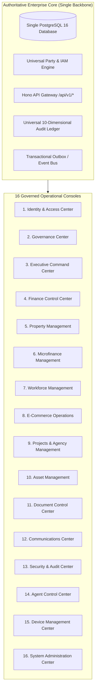
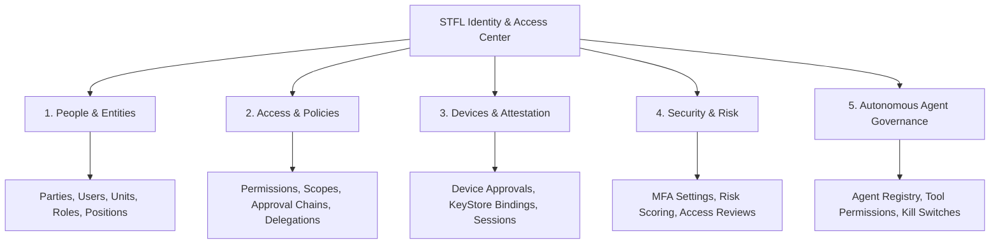

# STFL AIO — Unified Management Backends Architecture

**System:** SohaelTasneem Foundation (STFL) Autonomous Enterprise Platform  
**Document Identity:** `STFL-DOC-2026-MGMT-BKND-V1`  
**Date:** 2026-10-15  
**Status:** ARCHITECTURAL SPECIFICATION — RATIFIED (PHASE 0C)  
**Security Level:** INTERNAL USE ONLY

---

## 1. Unified Multi-Console Philosophy

STFL AIO deliberately rejects the anti-pattern of a "single giant monolithic admin dashboard" where every administrative user sees the same cluttered navigation tree. 

Instead, the platform introduces **16 Dedicated, Controlled Operational Consoles**. 

### Critical Architecture Rule
All 16 consoles share:
* **The exact same PostgreSQL database**: No database fragmentation or data silos.
* **The exact same API gateway**: Standard `/api/v1/*` contracts.
* **The exact same audit pipeline**: All actions write to `audit_logs`.
* **The exact same policy evaluator**: Centralized RBAC + ABAC scope engine.

---

## 2. Directory of the 16 Governed Management Consoles

### 1. Identity & Access Center (`/admin/iam`)
* **Primary Users**: Class 00 (Super Admin), Class 07 (Security Officer).
* **Scope**: Comprehensive management of Parties, Users, Credentials, Roles, Scopes, Approval Chains, and Delegations. (Deep-dive in §3).

### 2. Governance Center (`/admin/governance`)
* **Primary Users**: Class 01 (Trustees & Board Members).
* **Scope**: Board resolutions, statutory trust filings, waqf deed oversight, institutional risk heatmaps, Level 5 dual-control approvals.

### 3. Executive Command Center (`/admin/executive`)
* **Primary Users**: Class 02 (Chairperson, CEO, Executive Director, COO).
* **Scope**: Cross-unit key performance indicators, strategic budget utilization, humanitarian emergency declarations, executive escalations.

### 4. Finance Control Center (`/admin/finance`)
* **Primary Users**: Class 06 (Finance Specialists), Class 03 (Finance Head).
* **Scope**: Chart of accounts, double-entry vouchers, automated bank feed reconciliation, donor restricted fund ledgers (Zakat, Sadaqah, Waqf).

### 5. Property Management Console (`/admin/property`)
* **Primary Users**: Class 03 (Property Head), Class 04 (Property Officers).
* **Scope**: Property portfolio, unit vacancies, commercial vs residential tenancy classes, lease contracts, utility meter readings, repair schedules.

### 6. Microfinance Management Console (`/admin/microfinance`)
* **Primary Users**: Class 03 (MFI Head), Class 04 (Collection Supervisors).
* **Scope**: Qard Hasan loan portfolios, borrower risk scoring, repayment schedules, collection route assignment, delinquency tracking.

### 7. Workforce Management Console (`/admin/workforce`)
* **Primary Users**: Class 09 (HR Admin), Class 03 (Department Heads).
* **Scope**: Staff & volunteer directory, geofenced mobile check-in audits, leave requests, shift rosters, stipend & payroll preparation.

### 8. E-Commerce Operations Console (`/admin/eshop`)
* **Primary Users**: Class 03 (E-Commerce Head), Class 04 (Warehouse Supervisors).
* **Scope**: Craft & artisan catalog, warehouse SKU balances, automated purchase orders, order dispatch routing, customer delivery tracking.

### 9. Projects & Agency Management Console (`/admin/projects`)
* **Primary Users**: Class 03 (Agency Head), Class 04 (Project Officers).
* **Scope**: Disaster relief logistics, beneficiary survey campaigns, project milestones, donor impact reporting.

### 10. Asset Management Console (`/admin/assets`)
* **Primary Users**: Class 04 (Asset Officers), Class 03 (Admin Head).
* **Scope**: Fixed asset register, straight-line depreciation schedules, physical QR/NFC tag audits, asset disposal requests.

### 11. Document Control Center (`/admin/documents`)
* **Primary Users**: Class 08 (Document Officers).
* **Scope**: Official bilingual templates (`STFL-TPL-*`), digital document issuance, cryptographic hash verification, document revocation, public verification portal management.

### 12. Communications Center (`/admin/communications`)
* **Primary Users**: Class 04 (Comms Officers), Class 03 (Comms Head).
* **Scope**: Governed WhatsApp, Email, and SMS gateway dispatch, bilingual template registration, delivery receipts, outbound rate limiting.

### 13. Security & Audit Center (`/admin/security`)
* **Primary Users**: Class 07 (Security & Audit Officers).
* **Scope**: Hardware device attestation review, suspicious login forensics, session revocation, one-time print token audits, agent kill-switch execution.

### 14. Agent Control Center (`/admin/agents`)
* **Primary Users**: Class 07 (Security), Class 02 (Executive), Class 03 (Unit Heads).
* **Scope**: Autonomous agent registry (`STFL-AGT-*`), tool whitelisting, daily budget limits, confidence score monitoring, task failure triage.

### 15. Device Management Center (`/admin/devices`)
* **Primary Users**: Class 07 (Security Officers).
* **Scope**: Mobile hardware binding requests (`PENDING` $\rightarrow$ `ACTIVE`), KeyStore attestation state, compromised device blacklisting.

### 16. System Administration Center (`/admin/system`)
* **Primary Users**: Class 00 (Platform Super Admin).
* **Scope**: Database migration execution, Hyperdrive connection pool metrics, Cloudflare edge caching policies, R2 storage bucket configuration.

---

## 3. Deep-Dive: Identity & Access Center (First Priority Backend)

The **Identity & Access Center** is the foundation upon which all other 15 consoles operate. It is structured into five operational modules:

### 3.1 People & Entities Management
* **Parties Directory**: View, create, and verify `PERSON`, `ORGANIZATION`, `COMPANY`, and `HOUSEHOLD` entities.
* **User Accounts**: Manage credentials, Argon2id passwords, and link user accounts directly to verified `party_id`s.
* **Organizational Structure**: Define departments (Finance, Property, Microfinance, HR, Agency, E-Commerce, Admin) and structural reporting lines.

### 3.2 Access, Scopes & Policies
* **Role Catalogue**: Maintain granular permission strings and role assignments.
* **Scope Configuration**: Create and bind operational scopes (e.g. `REGION-DHAKA-NORTH`, `PROPERTY-STFL-PRP-0001`).
* **Approval Chain Designer**: Define policy rules specifying approval thresholds (e.g. "Microfinance loan > 30,000 BDT requires Unit Head approval").

### 3.3 Devices & Hardware Binding
* **Pending Approvals Queue**: Live dashboard of field devices seeking activation.
* **Hardware Attestation Telemetry**: Review KeyStore public key blobs, MediaDrm status, and Android OS patch levels.
* **Instant Session Revocation**: One-click kill switch to terminate stolen or compromised devices.

### 3.4 Security & Threat Intelligence
* **Login Forensics**: IP-hashed geolocation logs and brute-force attempt counters.
* **Access Reviews**: Periodic automated re-certification prompts for staff privilege maintenance.

### 3.5 Autonomous Agent Control Interface
* **Agent Whitelist Configuration**: Bind permitted tool sets to individual agents.
* **Emergency Agent Kill Switch**: Global and per-agent pause buttons that instantly halt agent task execution across the Worker fleet.
