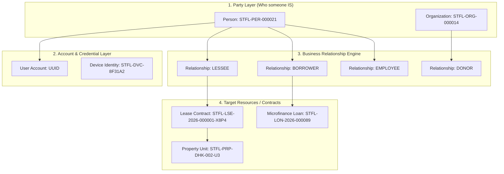
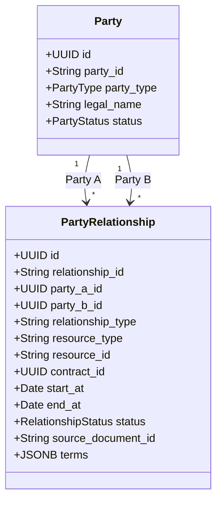
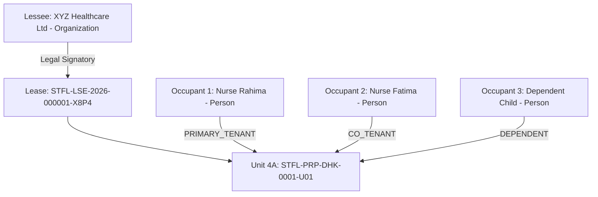

# STFL AIO — Party & Relationship Identity Specification

**System:** SohaelTasneem Foundation (STFL) Autonomous Enterprise Platform  
**Document Identity:** `STFL-DOC-2026-PARTY-REL-V1`  
**Date:** 2026-10-15  
**Status:** ARCHITECTURAL SPECIFICATION — RATIFIED (PHASE 0A)  
**Security Level:** INTERNAL USE ONLY

---

## 1. Core Architectural Principle: Identity vs. Relationship vs. Role

In STFL AIO, **who an entity is** (Party) is strictly decoupled from **what account they possess** (User Account), **what role they perform** (Role), and **what legal or operational relationship they have with resources and other parties** (Relationship).



### The "Tenant" Fallacy Neutralized
`TENANT` is **never** a permanent user class, user type, or role in the system.
* A human being is a **`PERSON` Party** (e.g. `STFL-PER-000021`).
* That person enters into a legal **`LESSEE` Relationship** under a specific **`LEASE` Contract** (e.g. `STFL-LSE-2026-000001-X8P4`) tied to a **`PROPERTY UNIT` Resource**.
* The same person may simultaneously be an **`EMPLOYEE`** of the foundation, a **`DONOR`** to a healthcare drive, and an **`ACCOUNT_HOLDER`**.
* When the lease expires or terminates, the person remains the exact same Party; only that specific relationship changes status to `EXPIRED` or `TERMINATED`.

---

## 2. The Generic Party Abstraction

A Party represents any legal, natural, or recognized collective entity capable of entering relationships, holding property, signing contracts, or receiving funds.

### 2.1 Supported Party Types
```text
PERSON                  Natural individual
ORGANIZATION            General institution / agency
COMPANY                 Commercial corporation / registered business
GOVERNMENT_ENTITY       Statutory body / ministry / municipal authority
NGO                     Non-governmental humanitarian organization
FOUNDATION              Endowment / charitable foundation (e.g. STFL itself)
TRUST                   Legal trust holding endowments or waqf assets
HOUSEHOLD               Co-habiting familial or socio-economic unit (relief/microfinance)
OTHER_LEGAL_ENTITY      Statutory committee, cooperative society, or waqf estate
```

### 2.2 Institutional Party Identifiers
Parties receive an immutable internal UUID plus a human-readable Institutional Identifier:
* Person: `STFL-PER-{SEQUENCE:6}` (e.g. `STFL-PER-000021`)
* Organization: `STFL-ORG-{SEQUENCE:6}` (e.g. `STFL-ORG-000014`)
* Company / Commercial: `STFL-CMP-{SEQUENCE:6}` (e.g. `STFL-CMP-000018`)
* Household: `STFL-HH-{SEQUENCE:6}` (e.g. `STFL-HH-000031`)
* Trust / Waqf Estate: `STFL-TRU-{SEQUENCE:6}` (e.g. `STFL-TRU-000005`)

> [!IMPORTANT]
> **Identity Invariance Rule**: Email addresses, mobile phone numbers, national ID numbers, and display names are mutable attributes. They are **never** used as immutable database primary keys or identity anchors.

### 2.3 Party Database Schema (`parties`)
```sql
CREATE TABLE IF NOT EXISTS parties (
    id                   UUID PRIMARY KEY DEFAULT gen_random_uuid(),
    party_id             TEXT NOT NULL UNIQUE,          -- STFL-PER-000021
    party_type           TEXT NOT NULL CHECK (party_type IN (
                           'PERSON', 'ORGANIZATION', 'COMPANY', 
                           'GOVERNMENT_ENTITY', 'NGO', 'FOUNDATION', 
                           'TRUST', 'HOUSEHOLD', 'OTHER_LEGAL_ENTITY'
                         )),
    legal_name_bn        TEXT NOT NULL,
    legal_name_en        TEXT NOT NULL,
    trade_name           TEXT,
    national_id_hash     TEXT,                          -- SHA-256(NID/Passport/SmartCard)
    tax_identifier_hash  TEXT,                          -- SHA-256(TIN/BIN)
    primary_contact_json JSONB NOT NULL DEFAULT '{}'::jsonb, -- Verified phone/email metadata
    address_json         JSONB NOT NULL DEFAULT '{}'::jsonb,
    status               TEXT NOT NULL DEFAULT 'ACTIVE'
                         CHECK (status IN ('ACTIVE', 'PENDING_VERIFICATION', 'SUSPENDED', 'MERGED', 'DECEASED', 'DISSOLVED')),
    metadata             JSONB NOT NULL DEFAULT '{}'::jsonb,
    created_at           TIMESTAMPTZ NOT NULL DEFAULT now(),
    updated_at           TIMESTAMPTZ NOT NULL DEFAULT now()
);

CREATE INDEX IF NOT EXISTS idx_parties_type ON parties (party_type);
CREATE INDEX IF NOT EXISTS idx_parties_status ON parties (status);
CREATE INDEX IF NOT EXISTS idx_parties_nid_hash ON parties (national_id_hash) WHERE national_id_hash IS NOT NULL;
```

---

## 3. The Universal Party Relationship Engine

All business interactions across all 7 STFL units are modeled through the generic `party_relationships` table. Relationships connect **Party A** to **Party B** (or Party A to a Resource/Contract) under explicit temporal, legal, and operational terms.



### 3.1 Relationship Schema Definition
```sql
CREATE TABLE IF NOT EXISTS party_relationships (
    id                   UUID PRIMARY KEY DEFAULT gen_random_uuid(),
    relationship_id      TEXT NOT NULL UNIQUE,          -- STFL-REL-2026-000492
    party_a_id           UUID NOT NULL REFERENCES parties(id) ON DELETE RESTRICT,
    party_b_id           UUID REFERENCES parties(id) ON DELETE RESTRICT,
    relationship_type    TEXT NOT NULL,                 -- e.g. LESSOR, LESSEE, EMPLOYEE, BORROWER
    resource_type        TEXT,                          -- e.g. property, property_unit, loan, project
    resource_id          TEXT,                          -- Institutional resource reference
    contract_id          UUID,                          -- Links to leases or contracts
    organization_id      UUID REFERENCES parties(id) ON DELETE RESTRICT, -- Contextual STFL unit
    scope_id             TEXT,                          -- Geofence / Unit / Regional boundary
    start_at             TIMESTAMPTZ NOT NULL,
    end_at               TIMESTAMPTZ,                   -- NULL represents indefinite relationship
    status               TEXT NOT NULL DEFAULT 'ACTIVE'
                         CHECK (status IN (
                           'PENDING', 'ACTIVE', 'SUSPENDED', 'EXPIRED', 
                           'TERMINATED', 'REVOKED', 'DISPUTED', 'CANCELLED'
                         )),
    source_document_id   TEXT,                          -- STFL-DOC-... instrument establishing relationship
    metadata             JSONB NOT NULL DEFAULT '{}'::jsonb,
    created_at           TIMESTAMPTZ NOT NULL DEFAULT now(),
    updated_at           TIMESTAMPTZ NOT NULL DEFAULT now(),
    CONSTRAINT rel_parties_distinct CHECK (party_b_id IS NULL OR party_a_id <> party_b_id)
);

CREATE INDEX IF NOT EXISTS idx_party_rel_a ON party_relationships (party_a_id, relationship_type, status);
CREATE INDEX IF NOT EXISTS idx_party_rel_b ON party_relationships (party_b_id, relationship_type, status);
CREATE INDEX IF NOT EXISTS idx_party_rel_resource ON party_relationships (resource_type, resource_id);
CREATE INDEX IF NOT EXISTS idx_party_rel_dates ON party_relationships (start_at, end_at);
```

### 3.2 Relationship Status Lifecycle
* **`PENDING`**: Agreement drafted or awaiting physical counter-signature / deposit payment.
* **`ACTIVE`**: Fully effective and legally enforceable.
* **`SUSPENDED`**: Temporarily frozen due to dispute, court stay, or compliance investigation.
* **`EXPIRED`**: Term reached without renewal; obligations transition to settlement.
* **`TERMINATED`**: Ended early by mutual consent, default clause, or eviction notice.
* **`REVOKED`**: Nullified ab initio due to fraud, forgery, or misrepresentation.
* **`DISPUTED`**: Formal dispute or arbitration proceedings underway.
* **`CANCELLED`**: Cancelled prior to effective date.

---

## 4. Property, Estate & Waqf Model

The property architecture enforces rigorous legal separation between **Ownership**, **Leasing**, **Physical Occupancy**, and **Property Classification**.

### 4.1 Property Classification vs. Tenancy Class
Property physical classification is independent from the legal tenancy class.

| Physical Classification (`property_class`) | Tenancy Classification (`tenancy_class`) | Example Real-World Context |
|---|---|---|
| `RESIDENTIAL` | `RESIDENTIAL` | Apartment leased to a family for living. |
| `RESIDENTIAL` | `COMMERCIAL` | Residential house legally rented as a boutique design studio or doctor's clinic. |
| `COMMERCIAL` | `COMMERCIAL` | Retail storefront leased to a merchant. |
| `MIXED_USE` | `ORGANIZATIONAL` | Floor 1: Retail pharmacy; Floor 2: STFL field humanitarian office. |
| `RELIGIOUS` / `WAQF` | `CHARITABLE` | Waqf land designated for community vocational training. |
| `AGRICULTURAL` | `NON_COMMERCIAL` | Farm land leased to cooperative subsistence farmers under Qard Hasan terms. |

```sql
CREATE TABLE IF NOT EXISTS properties_v2 (
    id                   UUID PRIMARY KEY DEFAULT gen_random_uuid(),
    property_code        TEXT NOT NULL UNIQUE,          -- STFL-PRP-DHK-0001
    title_bn             TEXT NOT NULL,
    title_en             TEXT NOT NULL,
    property_class       TEXT NOT NULL CHECK (property_class IN (
                           'RESIDENTIAL', 'COMMERCIAL', 'INDUSTRIAL', 'AGRICULTURAL', 
                           'OFFICE', 'RETAIL', 'WAREHOUSE', 'MIXED_USE', 
                           'INSTITUTIONAL', 'RELIGIOUS', 'CHARITABLE', 'COMMUNITY', 
                           'VACANT', 'OTHER'
                         )),
    is_waqf              BOOLEAN NOT NULL DEFAULT FALSE,
    waqf_estate_name     TEXT,
    address_text         TEXT NOT NULL,
    division             TEXT NOT NULL,
    district             TEXT NOT NULL,
    upazila_thana        TEXT NOT NULL,
    geo_point            JSONB,                         -- {"lat": 23.81, "lng": 90.41}
    deed_reference       TEXT,
    mutation_number      TEXT,
    status               TEXT NOT NULL DEFAULT 'ACTIVE'
                         CHECK (status IN ('ACTIVE', 'DISPUTED', 'UNDER_CONSTRUCTION', 'DISPOSED')),
    created_at           TIMESTAMPTZ NOT NULL DEFAULT now(),
    updated_at           TIMESTAMPTZ NOT NULL DEFAULT now()
);

CREATE TABLE IF NOT EXISTS property_units (
    id                   UUID PRIMARY KEY DEFAULT gen_random_uuid(),
    unit_code            TEXT NOT NULL UNIQUE,          -- STFL-PRP-DHK-0001-U01
    property_id          UUID NOT NULL REFERENCES properties_v2(id) ON DELETE RESTRICT,
    floor_level          TEXT NOT NULL,
    unit_label           TEXT NOT NULL,                 -- e.g. "Flat 4A" or "Shop G-12"
    area_sqft            NUMERIC(10, 2) NOT NULL,
    default_use          TEXT NOT NULL,
    meter_identifiers    JSONB NOT NULL DEFAULT '{}'::jsonb, -- Electric, Gas, Water meters
    is_occupied          BOOLEAN NOT NULL DEFAULT FALSE,
    status               TEXT NOT NULL DEFAULT 'VACANT'
                         CHECK (status IN ('VACANT', 'LEASED', 'UNDER_MAINTENANCE', 'RESERVED')),
    created_at           TIMESTAMPTZ NOT NULL DEFAULT now(),
    updated_at           TIMESTAMPTZ NOT NULL DEFAULT now()
);
```

### 4.2 Ownership & Management Relationships
Ownership of a property is modeled via `party_relationships`:
```text
PARTY A (STFL Foundation)       ──[ OWNER ]──────────────► Property STFL-PRP-DHK-0001
PARTY B (Tasneem Waqf Trust)   ──[ WAQF_ADMINISTRATOR ]──► Property STFL-PRP-DHK-0001
PARTY C (Mr. Farhan Rahman)     ──[ PROPERTY_MANAGER ]───► Property STFL-PRP-DHK-0001
```

---

## 5. Lease as a First-Class Entity

A Lease is an authoritative contract, not a loose attribute on a property row.

```sql
CREATE TABLE IF NOT EXISTS leases (
    id                        UUID PRIMARY KEY DEFAULT gen_random_uuid(),
    lease_code                TEXT NOT NULL UNIQUE,          -- STFL-LSE-2026-000001-X8P4
    unit_id                   UUID NOT NULL REFERENCES property_units(id) ON DELETE RESTRICT,
    lessor_party_id           UUID NOT NULL REFERENCES parties(id) ON DELETE RESTRICT,
    lessee_party_id           UUID NOT NULL REFERENCES parties(id) ON DELETE RESTRICT,
    tenancy_class             TEXT NOT NULL CHECK (tenancy_class IN (
                                'COMMERCIAL', 'NON_COMMERCIAL', 'RESIDENTIAL', 'ORGANIZATIONAL', 'OTHER'
                              )),
    occupancy_type            TEXT NOT NULL CHECK (occupancy_type IN ('SOLE', 'JOINT', 'CORPORATE', 'INSTITUTIONAL')),
    property_use_clause       TEXT NOT NULL,
    start_date                DATE NOT NULL,
    end_date                  DATE NOT NULL,
    rent_amount               NUMERIC(18, 2) NOT NULL,       -- Stored exactly; NEVER float
    currency                  CHAR(3) NOT NULL DEFAULT 'BDT',
    security_deposit          NUMERIC(18, 2) NOT NULL DEFAULT 0.00,
    payment_cycle             TEXT NOT NULL CHECK (payment_cycle IN ('MONTHLY', 'QUARTERLY', 'BI_ANNUAL', 'ANNUAL')),
    due_day_of_month          SMALLINT NOT NULL DEFAULT 5 CHECK (due_day_of_month BETWEEN 1 AND 31),
    escalation_clause_json    JSONB NOT NULL DEFAULT '{}'::jsonb, -- e.g. {"rate": 10.0, "frequency_years": 2}
    utility_responsibility    JSONB NOT NULL DEFAULT '{}'::jsonb, -- {"water": "tenant", "electric": "tenant", "gas": "landlord"}
    maintenance_responsibility JSONB NOT NULL DEFAULT '{}'::jsonb,
    notice_period_days        INTEGER NOT NULL DEFAULT 60,
    renewal_terms             TEXT,
    source_document_id        TEXT,                          -- STFL-DOC-... signed deed
    status                    TEXT NOT NULL DEFAULT 'PENDING'
                              CHECK (status IN (
                                'DRAFT', 'PENDING', 'ACTIVE', 'EXPIRING', 
                                'EXPIRED', 'RENEWAL_PENDING', 'RENEWED', 
                                'TERMINATED', 'CANCELLED', 'DISPUTED'
                              )),
    approved_by               UUID REFERENCES users(id) ON DELETE SET NULL,
    created_at                TIMESTAMPTZ NOT NULL DEFAULT now(),
    updated_at                TIMESTAMPTZ NOT NULL DEFAULT now(),
    CONSTRAINT lease_dates_valid CHECK (end_date > start_date)
);

CREATE INDEX IF NOT EXISTS idx_leases_unit ON leases (unit_id);
CREATE INDEX IF NOT EXISTS idx_leases_lessee ON leases (lessee_party_id);
CREATE INDEX IF NOT EXISTS idx_leases_status ON leases (status);
```

---

## 6. Physical Occupancy Decoupled from Lease

Physical human occupants on the ground frequently differ from the signatory Lessee (e.g. an organization leases an apartment for 4 trainee nurses; a father leases a unit where his adult son resides).



### Occupancy Schema (`unit_occupancies`)
```sql
CREATE TABLE IF NOT EXISTS unit_occupancies (
    id                   UUID PRIMARY KEY DEFAULT gen_random_uuid(),
    unit_id              UUID NOT NULL REFERENCES property_units(id) ON DELETE RESTRICT,
    lease_id             UUID REFERENCES leases(id) ON DELETE CASCADE,
    occupant_party_id    UUID NOT NULL REFERENCES parties(id) ON DELETE RESTRICT,
    occupancy_role       TEXT NOT NULL CHECK (occupancy_role IN (
                           'PRIMARY_TENANT', 'CO_TENANT', 'AUTHORIZED_OCCUPANT', 
                           'DEPENDENT', 'EMPLOYEE_OCCUPANT', 'GUEST', 
                           'CARETAKER', 'UNAUTHORIZED_OCCUPANT'
                         )),
    start_date           DATE NOT NULL,
    end_date             DATE,
    emergency_contact    JSONB,
    police_verification_status TEXT NOT NULL DEFAULT 'PENDING' CHECK (police_verification_status IN ('PENDING', 'SUBMITTED', 'VERIFIED', 'EXEMPT')),
    status               TEXT NOT NULL DEFAULT 'ACTIVE' CHECK (status IN ('ACTIVE', 'VACATED', 'EVICTED')),
    created_at           TIMESTAMPTZ NOT NULL DEFAULT now()
);

CREATE INDEX IF NOT EXISTS idx_unit_occ_unit ON unit_occupancies (unit_id);
CREATE INDEX IF NOT EXISTS idx_unit_occ_party ON unit_occupancies (occupant_party_id);
```

---

## 7. Cross-Domain Enterprise Relationship Catalog

The exact same `party_relationships` table powers every other operational module:

| Domain | Relationship Type | Party A (Actor / Subject) | Party B (Counterparty / Organization) | Bound Resource |
|---|---|---|---|---|
| **Finance** | `LENDER` / `BORROWER` | Person or Household | STFL Microfinance Division | `microfinance_loans` |
| **Finance** | `GUARANTOR` | Co-signatory Person | STFL Microfinance Division | `microfinance_loans` |
| **Finance** | `DONOR` | Person or Philanthropic Corp | STFL Foundation | `donations` / `restricted_funds` |
| **Finance** | `PAYEE` | Vendor or Landlord | STFL Finance Department | `payment_vouchers` |
| **Workforce** | `EMPLOYEE` | Staff Member | STFL Organization | `hr_employees` |
| **Workforce** | `VOLUNTEER` | Registered Volunteer | STFL Programs Division | `programs` / `projects` |
| **Workforce** | `SUPERVISOR` | Department Head | Operational Staff Member | `hr_duty_logs` |
| **E-Commerce** | `CUSTOMER` | Retail Buyer | STFL Impact Shop | `orders` |
| **E-Commerce** | `VENDOR` / `ARTISAN` | Producer Cooperative | STFL Craft Division | `inventory_products` |
| **E-Commerce** | `DELIVERY_AGENT` | Last-Mile Courier | STFL Logistics Division | `delivery_dispatches` |
| **Humanitarian** | `BENEFICIARY` | Recipient Person or Family | STFL Disaster Relief Agency | `relief_distributions` |
| **Humanitarian** | `IMPLEMENTING_PARTNER` | Local Community NGO | STFL Field Operations | `projects` |
| **Governance** | `TRUSTEE` | Board Member | SohaelTasneem Foundation | `board_resolutions` |
| **Governance** | `AUTHORIZED_SIGNATORY` | Director / Officer | Banking / Legal Authorities | `statutory_filings` |
| **Documents** | `ISSUER` / `RECIPIENT` | Issuing Officer | Beneficiary / Employee / Tenant | `digital_documents` |
| **Documents** | `WITNESS` | Attesting Witness | Counterparty | `leases` / `deeds` |

This establishes the comprehensive Party and Relationship architecture for STFL AIO.
