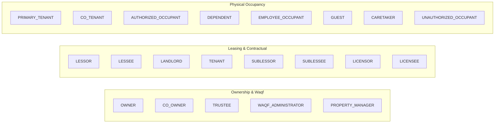

# STFL AIO — Enterprise Relationship Type Catalogue

**System:** SohaelTasneem Foundation (STFL) Autonomous Enterprise Platform  
**Document Identity:** `STFL-DOC-2026-REL-CAT-V1`  
**Date:** 2026-10-15  
**Status:** SPECIFICATION — RATIFIED (PHASE 0A)  
**Security Level:** INTERNAL USE ONLY

---

## 1. Universal Relationship Rules

All operational and legal links in STFL AIO are instances of `party_relationships`. 

Every relationship entry must conform to the following invariants:
1. **Explicit Counterparty**: Both Party A and Party B (or Party A and an explicit Bound Resource) must be registered entities in the system.
2. **Temporal Bounds**: Relationships must define `start_at` and an optional `end_at`. Overlapping active conflicting relationships on the same exclusive resource (e.g. two primary lessees on the same unit) are rejected by database triggers.
3. **Source Instrument**: Formal relationships (leases, loans, waqf trusts, employment) must reference a supporting `digital_documents` identifier (`source_document_id`).

---

## 2. Property, Estate & Tenancy Domain

### Detailed Catalogue Table

| Relationship Code | Party A Type | Party B / Target Resource | Legal Context | Temporal Rules |
|---|---|---|---|---|
| `OWNER` | `FOUNDATION`, `TRUST`, `PERSON` | `properties_v2` | Title deed holder. | Indefinite until formal conveyance. |
| `WAQF_ADMINISTRATOR` | `FOUNDATION`, `TRUST` | `properties_v2` (is_waqf = true) | Mutawalli or waqf governing committee. | Bound to statutory waqf charter. |
| `PROPERTY_MANAGER` | `PERSON`, `COMPANY` | `properties_v2` | Operational agency to manage tenancy and repairs. | Annually renewable contract. |
| `LESSOR` | `FOUNDATION`, `PERSON` | `leases` | Entity granting the leasehold interest. | Bound to exact lease term dates. |
| `LESSEE` | `PERSON`, `COMPANY`, `ORGANIZATION`| `leases` | Entity assuming contractual obligation to pay rent. | Bound to exact lease term dates. |
| `PRIMARY_TENANT` | `PERSON` | `property_units` | Physical head of household occupying unit. | Bound to active lease or occupancy permit. |
| `CO_TENANT` | `PERSON` | `property_units` | Joint adult resident sharing tenancy rights. | Bound to primary lease. |
| `AUTHORIZED_OCCUPANT`| `PERSON` | `property_units` | Permitted resident (e.g. employee of lessee company).| Requires police verification record. |
| `DEPENDENT` | `PERSON` | `property_units` | Minor child or elderly parent residing with family. | Linked to primary tenant. |
| `CARETAKER` | `PERSON` | `properties_v2` | Physical custodian of building premises. | Bound to employment contract. |

---

## 3. Microfinance & Qard Hasan Domain

| Relationship Code | Party A Type | Party B / Target Resource | Functional Role | Operational Rules |
|---|---|---|---|---|
| `LENDER` | `FOUNDATION` (Microfinance Unit) | `microfinance_loans` | Institutional fund provider. | Governed by Qard Hasan zero-usury policy. |
| `BORROWER` | `PERSON`, `HOUSEHOLD` | `microfinance_loans` | Primary recipient of micro-credit capital. | Bound to repayment installment schedule. |
| `CO_BORROWER` | `PERSON` | `microfinance_loans` | Joint family signatory sharing debt liability. | Must reside in same household. |
| `GUARANTOR` | `PERSON` | `microfinance_loans` | Community member vouching for borrower. | Cannot be an active defaulted borrower. |
| `COLLECTION_OFFICER` | `PERSON` (Class 05) | `microfinance_borrowers` | Field staff assigned to daily collection route. | Geographic scope enforced. |

---

## 4. Finance & Philanthropy Domain

| Relationship Code | Party A Type | Party B / Target Resource | Functional Role | Auditing Rules |
|---|---|---|---|---|
| `DONOR` | `PERSON`, `ORGANIZATION`, `COMPANY`| `donations` / `restricted_funds` | Contributor of Zakat, Sadaqah, or Waqf funds. | Tax receipt generated; donor privacy protected. |
| `RECIPIENT` / `BENEFICIARY`| `PERSON`, `HOUSEHOLD` | `payment_vouchers` / `funds` | Recipient of charitable relief grant. | Must meet shariah poverty / need threshold. |
| `PAYOR` | `PERSON`, `ORGANIZATION` | `ledger_entries` | Party remitting funds into foundation accounts. | Bank reference / mobile transaction ID required. |
| `PAYEE` | `PERSON`, `COMPANY` | `payment_vouchers` | Vendor, landlord, or contractor receiving payment. | TIN/BIN verified; bank details encrypted. |
| `ACCOUNT_HOLDER` | `FOUNDATION` | Bank Accounts | Institutional bank account ownership. | Requires double trustee authorization to operate. |

---

## 5. Workforce, HR & Volunteer Domain

| Relationship Code | Party A Type | Party B / Target Resource | Functional Role | Governance Rules |
|---|---|---|---|---|
| `EMPLOYER` | `FOUNDATION` | `hr_employees` | Institutional employer. | Compliant with national labor laws. |
| `EMPLOYEE` | `PERSON` | `hr_employees` | Salaried administrative or field staff. | Subject to duty shift roasters & attendance. |
| `CONTRACTOR` | `PERSON`, `COMPANY` | Specific Projects | Independent contractor for construction / tech. | Bound to deliverables milestone contract. |
| `VOLUNTEER` | `PERSON` | `programs` | Unpaid community volunteer worker. | Safeguarding policy acknowledgment required. |
| `SUPERVISOR` | `PERSON` (Class 03/04) | Field Workers / Staff | Departmental manager directing tasks. | Approves leave and field expense logs. |

---

## 6. E-Commerce & Impact Shop Domain

| Relationship Code | Party A Type | Party B / Target Resource | Functional Role | Operational Rules |
|---|---|---|---|---|
| `SELLER` | `FOUNDATION` (Impact Shop) | `inventory_products` | Merchant offering ethical products. | Proceeds fund charitable foundation programs. |
| `BUYER` / `CUSTOMER` | `PERSON`, `ORGANIZATION` | `orders` | Purchaser of handicrafts or publications. | Order tracking and invoice delivery. |
| `VENDOR` / `ARTISAN` | `PERSON`, `COOPERATIVE` | `inventory_products` | Rural artisan producing goods. | Fair-trade guaranteed payment pricing. |
| `DELIVERY_AGENT` | `PERSON` (Class 05) | `delivery_dispatches` | Field staff or courier executing last-mile delivery.| OTP confirmation required from recipient. |

---

## 7. Governance, Legal & Document Domain

| Relationship Code | Party A Type | Party B / Target Resource | Legal Role | Authority Rules |
|---|---|---|---|---|
| `TRUSTEE` | `PERSON` (Class 01) | SohaelTasneem Foundation | Board of Trustees member. | Ultimate institutional fiduciary governance. |
| `AUTHORIZED_SIGNATORY`| `PERSON` (Class 01/02) | Bank accounts / Statutory deeds | Legal signatory registered with authorities. | Subject to dual-control threshold rules. |
| `ISSUER` | `PERSON` (Class 08/Unit Head)| `digital_documents` | Official issuing authority of an instrument. | Cryptographically signed document record. |
| `WITNESS` | `PERSON` | `leases` / `contracts` | Attesting witness present at agreement execution. | National ID and signature recorded. |
| `SIGNATORY` | `PERSON`, `COMPANY` | `leases` / `contracts` | Contractual executing party. | Bound by contractual clauses. |
