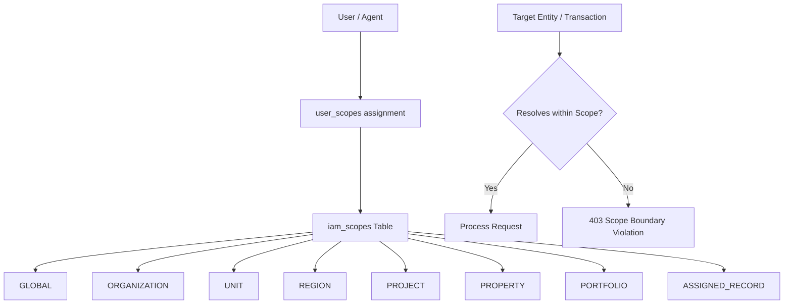
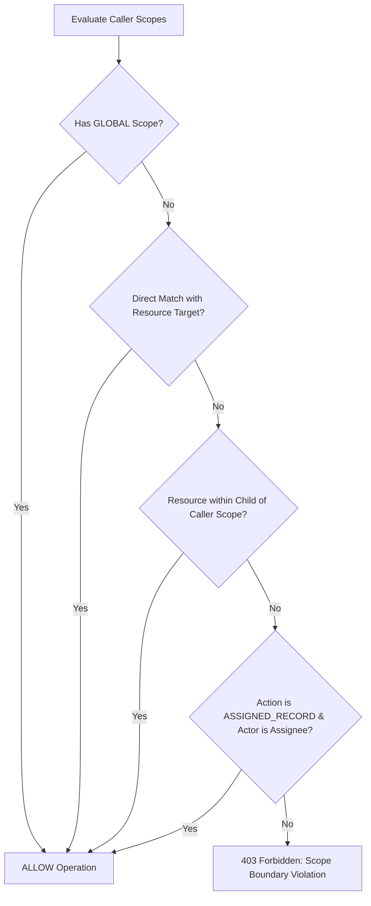

# STFL AIO — First-Class Scope Model Specification

**System:** SohaelTasneem Foundation (STFL) Autonomous Enterprise Platform  
**Document Identity:** `STFL-DOC-2026-SCOPE-V1`  
**Date:** 2026-10-15  
**Status:** SPECIFICATION — RATIFIED (PHASE 0B)  
**Security Level:** INTERNAL USE ONLY

---

## 1. Scope as a First-Class Citizen

In STFL AIO, **Scope is not an ad-hoc SQL `WHERE` clause** added after the fact. It is a first-class architectural primitive stored, assigned, and validated alongside permissions.



---

## 2. Supported Scope Types & Hierarchies

```text
GLOBAL
  └── ORGANIZATION (e.g. STFL Relief Trust)
        ├── UNIT (e.g. Microfinance Division)
        │     └── PORTFOLIO (e.g. Rural Women Entrepreneurship Portfolio)
        │           └── ASSIGNED_RECORD (e.g. Specific Loan STFL-LON-00089)
        └── REGION (e.g. Division: Dhaka -> District: Gazipur)
              └── PROPERTY (e.g. STFL-PRP-DHK-0001)
                    └── UNIT / APARTMENT (e.g. Unit 4A)
```

| Scope Type | Description | Target Entity Reference |
|---|---|---|
| **`GLOBAL`** | Foundation-wide authority across all assets and programs. | `*` (Restricted to Super Admin & Trustees). |
| **`ORGANIZATION`** | Specific corporate, trust, or legal subsidiary. | `party_id` of the target organization. |
| **`UNIT`** | Specific operating department. | Department code: `FINANCE`, `PROPERTY`, `MICROFINANCE`, etc. |
| **`REGION`** | Defined administrative or geographical boundary. | Division, District, or Upazila/Thana geo-code. |
| **`PROJECT`** | Dedicated humanitarian campaign or agency work. | `project_id` (e.g. `STFL-PRJ-2026-0012`). |
| **`PROPERTY`** | Specific physical estate, building, or Waqf asset. | `property_code` (e.g. `STFL-PRP-DHK-0001`). |
| **`PORTFOLIO`** | Group of loans, leases, or vendor contracts. | `portfolio_id`. |
| **`ASSIGNED_RECORD`** | Explicitly assigned records only. | Direct foreign key match (`assigned_to = actor_id`). |

---

## 3. Database Schema for First-Class Scopes

```sql
CREATE TABLE IF NOT EXISTS iam_scopes (
    id                   UUID PRIMARY KEY DEFAULT gen_random_uuid(),
    scope_code           TEXT NOT NULL UNIQUE,          -- e.g. SCP-REG-DHK-NORTH-01
    scope_type           TEXT NOT NULL CHECK (scope_type IN (
                           'GLOBAL', 'ORGANIZATION', 'UNIT', 'REGION', 
                           'PROJECT', 'PROPERTY', 'PORTFOLIO', 'ASSIGNED_RECORD'
                         )),
    name_bn              TEXT NOT NULL,
    name_en              TEXT NOT NULL,
    target_entity_type   TEXT,                          -- party, property, project, region
    target_entity_id     TEXT,                          -- specific UUID or canonical identifier
    parent_scope_id      UUID REFERENCES iam_scopes(id) ON DELETE SET NULL,
    metadata             JSONB NOT NULL DEFAULT '{}'::jsonb,
    is_active            BOOLEAN NOT NULL DEFAULT TRUE,
    created_at           TIMESTAMPTZ NOT NULL DEFAULT now()
);

CREATE INDEX IF NOT EXISTS idx_iam_scopes_type ON iam_scopes (scope_type);
CREATE INDEX IF NOT EXISTS idx_iam_scopes_target ON iam_scopes (target_entity_type, target_entity_id);

CREATE TABLE IF NOT EXISTS user_scopes (
    id                   UUID PRIMARY KEY DEFAULT gen_random_uuid(),
    user_id              UUID NOT NULL REFERENCES users(id) ON DELETE CASCADE,
    scope_id             UUID NOT NULL REFERENCES iam_scopes(id) ON DELETE CASCADE,
    role_id              INTEGER REFERENCES roles(id) ON DELETE CASCADE,
    valid_from           TIMESTAMPTZ NOT NULL DEFAULT now(),
    valid_until          TIMESTAMPTZ,                   -- Supports temporary operational delegation
    granted_by           UUID REFERENCES users(id) ON DELETE SET NULL,
    created_at           TIMESTAMPTZ NOT NULL DEFAULT now(),
    CONSTRAINT user_scope_unique UNIQUE (user_id, scope_id, role_id)
);

CREATE INDEX IF NOT EXISTS idx_user_scopes_user ON user_scopes (user_id);
```

---

## 4. Scope Resolution Algorithm

When an API route handles a request against an entity (e.g. property, loan, tenant, project):



### Real-World Example
```text
Officer Farhan Rahman is granted scope:
SCP-PRP-DHK-0002 (Property: STFL-PRP-DHK-0002)

He attempts to list tenancy documents for:
1. STFL-PRP-DHK-0002-U01:
   - Resource belongs to STFL-PRP-DHK-0002.
   - Matches Officer's assigned scope.
   - RESOLUTION: ALLOW.

2. STFL-PRP-KRN-0001-U03 (Keraniganj Property):
   - Resource belongs to STFL-PRP-KRN-0001.
   - Does NOT match Officer's assigned scope.
   - RESOLUTION: DENIED 403.
```
