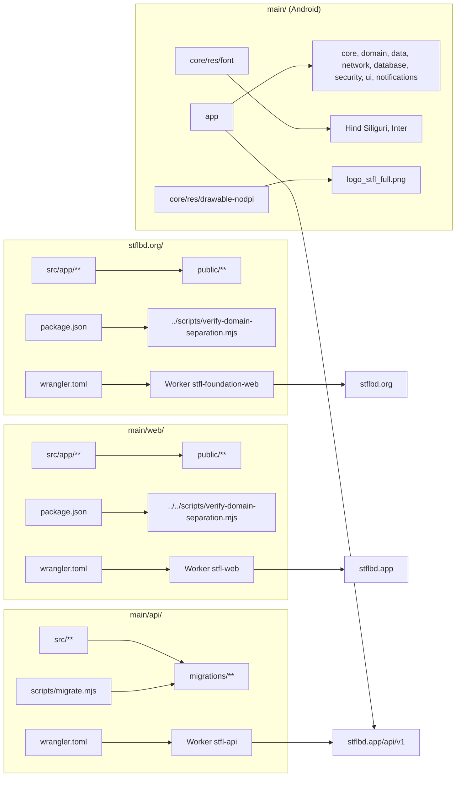

# STFL Dependency Map

What depends on what. Derived from [`../.control/production-dependency-map.json`](./.control/production-dependency-map.json).

**Rule:** before moving any file, find it here. If it is not here, it is not safe to move.

---

## 1. Deployable dependency chains

---

## 2. Cross-directory path dependencies

These are the references that make a folder move unsafe.

| Reference | File | Resolves to | Breaks if moved |
|---|---|---|---|
| `node ../../scripts/verify-domain-separation.mjs` | `main/web/package.json` | `<root>/scripts/verify-domain-separation.mjs` | **Yes** — `npm run build` runs `verify` first |
| `node ../scripts/verify-domain-separation.mjs` | `stflbd.org/package.json` | `<root>/scripts/verify-domain-separation.mjs` | **Yes** — `npm run build` runs `verify` first |
| `import { hashPassword } from '../src/crypto.ts'` | `main/api/scripts/seed-dev.mjs` | `main/api/src/crypto.ts` | Yes, if `scripts/` or `src/` moves |

> These three references are the concrete reason `main/` and `stflbd.org/` were **not** moved into `stfl-main/`.

---

## 3. Asset dependencies

Every asset below is **referenced by production code**. The Brand Center holds a canonical copy; the production path is unchanged.

| Asset | Production path | Referenced by | Action |
|---|---|---|---|
| `stfl-mark-dark.png` | `stflbd.org/public/` | `initiatives/grihostios/page.tsx:677` | COPY only |
| `stfl-mark-white.png` | `stflbd.org/public/` | `login/page.tsx:34`, `signup/page.tsx:35`, `main/web/src/app/AppLandingPage.tsx:48,808`, `download/page.tsx:24` | COPY only |
| `stfl-mark-transparent.png` | `stflbd.org/public/` | `admin/layout.tsx:203`, `brand/page.tsx:213,287,737`, `brandcenter/page.tsx:124` | COPY only |
| `stfl-logo-transparent.png` | `stflbd.org/public/` | `brand/page.tsx:48,183`, `brandcenter/page.tsx:132` | COPY only |
| `stfl-original-logo.png` | `stflbd.org/public/` | `brandcenter/page.tsx:140`, `main/docs/PLAY_STORE_LISTING.md:96` | COPY only |
| `stfl-wordmark-cream.png` | `stflbd.org/public/` | `brandcenter/page.tsx:148` | COPY only |
| `stfl-wordmark-transparent.png` | `stflbd.org/public/` | `brand/page.tsx:225`, `brandcenter/page.tsx:166` | COPY only |
| `stfl-wordmark-white.png` | `stflbd.org/public/` | `brand/page.tsx:195`, `brandcenter/page.tsx:157` | COPY only |
| `dot-matrix-hero.png` | `stflbd.org/public/media/` | `page.tsx:59` | COPY only |
| `grihostios-logo.svg` | `stflbd.org/public/media/` | `page.tsx:526`, `brandcenter/page.tsx:178`, `initiatives/grihostios/page.tsx:60`, `lib/initiativesRegistry.ts:165` (both apps) | COPY only |
| `skillconnect-logo.svg` | `stflbd.org/public/media/` | `page.tsx:537`, `brandcenter/page.tsx:187`, `lib/initiativesRegistry.ts:312` (both apps) | COPY only |
| `aev-logo.svg` | `stflbd.org/public/media/` | `brandcenter/page.tsx:196`, `lib/initiativesRegistry.ts:443` | COPY only |
| `maxremit-logo.svg` | `stflbd.org/public/media/` | `page.tsx:559`, `brandcenter/page.tsx:205`, `lib/initiativesRegistry.ts:559` | COPY only |
| `helpex-logo.svg` | `stflbd.org/public/media/` | `brandcenter/page.tsx:214`, `lib/initiativesRegistry.ts:675` | COPY only |
| `perlu-logo.svg` | `stflbd.org/public/media/` | `brandcenter/page.tsx:232`, `lib/initiativesRegistry.ts:917` | COPY only |
| `oiix-logo.svg` | `stflbd.org/public/media/` | `brandcenter/page.tsx:241`, `lib/initiativesRegistry.ts:1036` | COPY only |
| `proiozon-logo.png` | `stflbd.org/public/media/` | `page.tsx:548`, `brandcenter/page.tsx:223`, `lib/initiativesRegistry.ts:790` | COPY only |
| `qimai-logo.svg`, `qimai-symbol.svg` | `stflbd.org/public/media/` | `initiatives/qimai/page.tsx:143` | COPY only |
| `hakimsarker-logo.svg`, `-symbol.svg`, `-portrait.svg` | `stflbd.org/public/media/` | `initiatives/hakimsarker/page.tsx:240,373` | COPY only |
| `logo_stfl_full.png` | `main/core/src/main/res/drawable-nodpi/` | `core/ui/brand/StflLogo.kt:55,62` | COPY only (Android resource) |
| `HindSiliguri-*.ttf` | `stflbd.org/public/fonts/`, `main/web/public/fonts/`, `main/core/src/main/res/font/`, `main/assets/branding/fonts/` | `layout.tsx` font loading, Android `res/font` | COPY only |
| `inter_variable.ttf` | `main/core/src/main/res/font/` | Android typography | COPY only |
| `favicon.ico` | `stflbd.org/src/app/`, `main/web/src/app/` | Next.js App Router convention | COPY only |

---

## 4. Build-system dependencies

| Build | Depends on | Path-sensitive |
|---|---|---|
| `main/web` `npm run build` | `scripts/verify-domain-separation.mjs`, `main/web/scripts/verify-icon-policy.mjs` | **Yes** |
| `stflbd.org` `npm run build` | `scripts/verify-domain-separation.mjs`, `stflbd.org/scripts/verify-icon-policy.mjs` | **Yes** |
| `main/api` `npm run build` | `main/api/wrangler.toml`, `main/api/src/index.ts` | Yes (within folder) |
| `main/api` `npm run db:migrate` | `main/api/migrations/`, `main/api/scripts/migrate.mjs` | Yes (within folder) |
| `main` `gradlew` | `main/settings.gradle.kts`, module `build.gradle.kts` files | Yes (within folder) |

---

## 5. Deployment dependencies

| Deployment | Depends on | Path-sensitive |
|---|---|---|
| `stfl-foundation-web` | `stflbd.org/wrangler.toml`, `stflbd.org/.open-next/` | Yes |
| `stfl-web` | `main/web/wrangler.toml`, `main/web/.open-next/` | Yes |
| `stfl-api` | `main/api/wrangler.toml`, `main/api/src/index.ts` | Yes |
| Android release | `main/app/build.gradle.kts`, `main/keystore.properties` | Yes |

---

## 6. Documentation dependencies

| Document | Depends on paths |
|---|---|
| `STFL_VI_CANONICAL_SOURCE_MAP.md` | 30+ `main/...` and `stflbd.org/...` implementation paths |
| `STFL_DOMAIN_SEPARATION_ARCHITECTURE.md` | `stflbd.org/`, `main/web/`, `main/api/`, `web/`, `apk/` |
| `stflbd.org/DOMAIN_RULE_FOR_ALL_AGENTS.md` | `STFL_DOMAIN_SEPARATION_ARCHITECTURE.md` |
| `main/web/DOMAIN_RULE_FOR_ALL_AGENTS.md` | `STFL_DOMAIN_SEPARATION_ARCHITECTURE.md` |

Moving a folder silently falsifies all of these.

---

## 7. Safe-to-move assessment

| Item | Safe to move? | Reason |
|---|---|---|
| `stflbd.org/` | **No** | Worker config, build path, canonical source map |
| `main/web/` | **No** | Worker config, `../../scripts` build path, canonical source map |
| `main/api/` | **No** | Worker config, migrations, canonical source map |
| `main/` (Android) | **No** | Gradle config, signing, canonical source map |
| `scripts/` | **No** | Referenced by both web builds |
| `web/` | Yes (to `_old/`) | Legacy, non-deployable — but no benefit, so left in place |
| `apk/` | Yes (to `_old/`) | Legacy, non-deployable — but no benefit, so left in place |
| `md-s/` | Yes | Documentation only, no build reference |
| `official_doc/` | Yes | Templates only, no build reference |
| `_old/` | Yes | Already an archive |
| `P1.pdf` | Yes | Unclassified, no reference |
| `hs_err_pid32616.log` | Yes | Build debris |

**Nothing was moved.** The portfolio layer was added alongside the existing structure.
