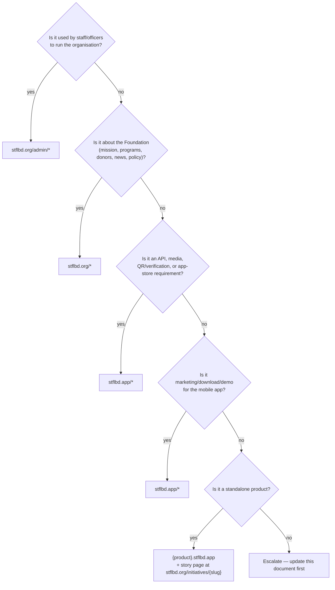

# STFL — MANDATORY DOMAIN SEPARATION RULE FOR ALL DEVELOPERS AND AGENTS

STOP.

Before adding or modifying any route, domain reference, or URL in STFL, read:

`STFL_DOMAIN_SEPARATION_ARCHITECTURE.md`

## The Rule in One Sentence

> **`stflbd.org` is the organisation. `stflbd.app` is the mobile app (its landing page and its backend). Nothing else.**

| Domain | Owns | Audience | Device focus |
|---|---|---|---|
| **`stflbd.org`** | Foundation's public website **and** the Enterprise Workspace (all `/admin/*` consoles: finance, IAM, HR/workforce, property, documents, compliance, governance, etc.) | Public, donors, partners, staff, officers, management | Public site: all devices. **Enterprise Workspace: desktop/PC first (mandatory)**, tablet supported |
| **`stflbd.app`** | Android app landing page, app download, product demo, app-required legal pages, public QR/document verification, **the API backend** (`/api/v1`), media, product sub-domains (`*.stflbd.app`) | App users, app stores, API clients (Android app **and** the `stflbd.org` workspace) | Mobile first |

---

## Decision Tree (§6.5)

---

## Single Source of Domain Constants

Never hard-code `stflbd.org` or `stflbd.app`. Always import from `src/lib/domains.ts`:

- `FOUNDATION_ORIGIN` = `"https://stflbd.org"`
- `APP_ORIGIN` = `"https://stflbd.app"`
- `API_BASE_URL` = `"https://stflbd.app/api/v1"`
- `VERIFY_ORIGIN` = `APP_ORIGIN`
- `SITE_ORIGIN` = this deployable's own origin
- `canonical(path)`

---

## PR / Agent Checklist

Before completing any task touching web pages or URLs:
- [ ] Which domain does this change belong to?
- [ ] Does any new URL follow `STFL_DOMAIN_SEPARATION_ARCHITECTURE.md` §3.2?
- [ ] No new hard-coded domain literals? (Use `src/lib/domains.ts`)
- [ ] Verification command executed: `npm run verify:domains` passes with 0 errors.
