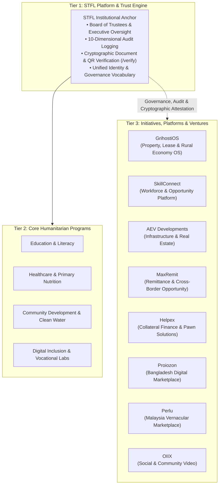

# STFL Ecosystem Architecture & Multi-Venture Foundation Model

**Document Identity:** `STFL-DOC-2026-ECO-ARCH-V1`  
**Parent Institution:** SohaelTasneem Foundation (STFL)  
**Effective Date:** 2026-10-16  
**Canonical Web Root:** `C:\Users\ShoebTahseen\Desktop\stfl\main\web`  
**Status:** RATIFIED & IMPLEMENTED  

---

## 1. Executive Vision & Ecosystem Philosophy

The SohaelTasneem Foundation (STFL) operates beyond the limitations of traditional non-governmental organizations. Rather than maintaining a rigid, static directory of top-down charitable hand-outs, STFL acts as a **Governed Impact Ecosystem** and an **Autonomous Institutional Operating Substrate**.

The core mission is anchored in three non-negotiable principles:
- **Human Dignity (মানব মর্যাদা):** Respecting the autonomy and self-determination of every individual.
- **Practical Action (বাস্তব পদক্ষেপ):** Delivering real, functional solutions to pressing social, economic, and logistical obstacles.
- **Measurable Impact (পরিমাপযোগ্য প্রভাব):** Grounding every intervention in verifiable outcomes, cryptographic receipts, and transparent audit trails.

### The Purpose-to-Scale Pathway
```
PURPOSE 
  → OPPORTUNITY 
  → ACTION 
  → CAPABILITY 
  → CONNECTION 
  → EVIDENCE 
  → IMPACT 
  → SCALE
```

In this architecture, field research uncovers real human needs; foundational capability is cultivated; projects are formed; successful initiatives crystallize into independent platforms, community operating systems, or sustainable ventures; and the shared STFL governance layer guarantees legal compliance, cryptographic trust, and financial integrity.

---

## 2. Institutional Topology & Multi-Tier Governance

To ensure operational agility while preventing brand dilution, legal liability, or data leakage, the STFL ecosystem is structured into three discrete institutional tiers:



### The Key Distinctions
1. **Programs (কর্মসূচি):** Direct public-benefit humanitarian interventions funded through foundation endowments and public donations.
2. **Initiatives & Ventures (উদ্যোগ ও ভেঞ্চার):** Autonomous platforms, specialized software operating systems, social enterprises, and commercial development vehicles that address systemic societal challenges through operational sustainability.
3. **External / Independent Entities:** Legally distinct partners and commercial entities (e.g. Varizen Inc.) that maintain separate corporate boundaries and are strictly excluded from the STFL Initiatives & Ventures directory.

---

## 3. The 8 Publication-Approved Initiatives & Ventures

| Initiative | Native Brand / Domain | Category | Core Mandate | Market / Scope |
|---|---|---|---|---|
| **GrihostiOS** | `grihostios.stflbd.app` | Property & Rural Economy | Property, urban lease, greenfield land, crop-share seasons (Barga/Adhi), and agreement generation. | Bangladesh (Urban & Rural) |
| **SkillConnect** | `skillconnect.stflbd.app` | Opportunity & Workforce | Decentralized workforce registration, credential verification, and safe cross-border migration matching. | Bangladesh & Regional Corridors |
| **AEV Developments** | `aev.stflbd.app` | Property & Infrastructure | Sustainable community physical infrastructure, low-cost rural clinics, and disaster-resilient housing. | Bangladesh |
| **MaxRemit** | `maxremit.stflbd.app` | Finance & Access | Cross-border remittance transparency, worker transfer corridors, and financial literacy. | Cross-border (MY/SG/BD) |
| **Helpex** | `helpex.my` | Finance & Access | Fair collateral valuation, asset-backed micro-liquidity, and transparent pawn custody framework. | Malaysia & Regional |
| **Proiozon** | `proiozon.com` | Digital & Marketplace | Bangla-first hyperlocal e-commerce, artisan catalog, and Harry AI shopping companion. | Bangladesh (64 Districts) |
| **Perlu** | `perlu.my` | Digital & Marketplace | Malaysia community marketplace, certified electronic device trade-in, and circular economy lifecycles. | Malaysia |
| **OIIX** | `oiix.fun` | Community & Culture | Community-driven video interactions, grassroots creative storytelling, and ethical WebRTC spaces. | Regional (South/SE Asia) |

---

## 4. Architectural Rules & Invariants

1. **Canonical Web Root Exclusivity:** All public routes and ecosystem components are developed within `C:\Users\ShoebTahseen\Desktop\stfl\main\web`.
2. **Varizen Inc. Separation:** Varizen Inc. is strictly excluded from the Initiatives & Ventures registry. No Varizen portfolio products or commercial profiles are merged into STFL.
3. **No Unverified Projects:** Projects categorized as `CONCEPT`, `EXPERIMENTAL`, or `UNVERIFIED` exist solely within internal administrative registries (`STFL_PROJECT_REGISTRY.json`) and are never published to public navigation.
4. **Native Logo Preservation:** Every initiative preserves its authentic native logo, colors, and typography. STFL does not homogenize distinct brands into generic icons.
5. **Universal Cryptographic Verification:** All receipts, certificates, and tenancy agreements generated by any initiative link back to the STFL master verification engine at `https://stflbd.app/verify`.
