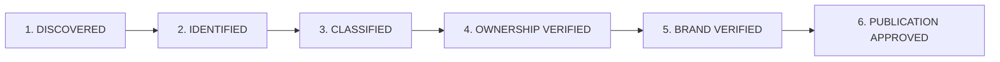

# STFL Project Publication & Verification Policy

**Document Identity:** `STFL-DOC-2026-PUB-POL-V1`  
**Parent System:** SohaelTasneem Foundation (STFL)  
**Effective Date:** 2026-10-16  
**Status:** RATIFIED & LOCKED  

---

## 1. The 6-Stage Publication Pipeline

To prevent preliminary notes, technical experiments, third-party companies, or unverified claims from being published on public STFL web channels, every entity must traverse a strict 6-stage qualification pipeline:

### Stage Definitions & Verification Criteria

1. **Stage 1: DISCOVERED**
   - The name, domain, or concept is discovered in repository history, code comments, spreadsheets, or directory listings.
   - *Status:* Strictly internal. Zero public visibility.

2. **Stage 2: IDENTIFIED**
   - The project's functional premise, target audience, and primary capability are explicitly documented in authoritative architectural files.
   - *Status:* Internal draft.

3. **Stage 3: CLASSIFIED**
   - The project is mapped into the canonical taxonomy (`Social Enterprise`, `Platform`, `Initiative`, `Venture`, etc.).
   - *Status:* Architecture specification.

4. **Stage 4: OWNERSHIP VERIFIED**
   - Legal ownership, fiduciary relationship, and organizational separation are confirmed by legal counsel or corporate filings.
   - *Boundary Check:* Entities such as Varizen Inc. are confirmed as independent and diverted away from STFL public venture listings.

5. **Stage 5: BRAND VERIFIED**
   - Authentic native logo files, color palettes, and typographic identities are located in the asset library and registered in `STFL_ECOSYSTEM_ASSET_REGISTER.json`.

6. **Stage 6: PUBLICATION APPROVED**
   - Signed off for public indexation on `stflbd.app/initiatives`, inclusion in the footer, and entry into the sitemap.

---

## 2. Current Project Status Audit

| Project | Pipeline Stage | Visibility | Public Route |
|---|---|---|---|
| **GrihostiOS** | Stage 6: APPROVED | Public | `/initiatives/grihostios` |
| **SkillConnect** | Stage 6: APPROVED | Public | `/initiatives/skillconnect` |
| **AEV Developments** | Stage 6: APPROVED | Public | `/initiatives/aev-developments` |
| **MaxRemit** | Stage 6: APPROVED | Public | `/initiatives/maxremit` |
| **Helpex** | Stage 6: APPROVED | Public | `/initiatives/helpex` |
| **Proiozon** | Stage 6: APPROVED | Public | `/initiatives/proiozon` |
| **Perlu** | Stage 6: APPROVED | Public | `/initiatives/perlu` |
| **OIIX** | Stage 6: APPROVED | Public | `/initiatives/oiix` |
| **Hashify** | Stage 3: CLASSIFIED | Internal Only | None (Excluded from public web) |
| **YourGiftCardSupply** | Stage 3: CLASSIFIED | Internal Only | None (Historical archive) |
| **Cikgu Fatimah** | Stage 2: IDENTIFIED | Internal Only | None (Exploratory incubation) |
| **Varizen Inc.** | Stage 4: EXCLUDED | Excluded | None (Independent commercial entity) |
